# ER diagram

> **Status: implemented in [schema.prisma](schema.prisma)** (M03), which is now the source of truth. Reflects DB-001 to
> DB-020 in [decisions.md](decisions.md); keep this diagram in sync with the schema.

Notation: `||` exactly one, `|o` zero or one, `o{` zero or more, `|{` one or more.
`PK` primary key, `FK` foreign key, `UK` unique.

```mermaid
erDiagram
  PROGRAMME ||--o{ PROGRAMME_FEE : "priced by"
  PROGRAMME ||--o{ STUDENT : enrols
  PROGRAMME ||--o{ PROGRAMME_MODULE : includes
  MODULE ||--o{ PROGRAMME_MODULE : "taught in"
  MODULE ||--o{ ASSESSMENT : has
  STUDENT ||--o{ STATUS_CHANGE : "status history"
  STUDENT ||--o{ FEE_CHARGE : owes
  PROGRAMME_FEE |o--o{ FEE_CHARGE : "copied into"
  STUDENT ||--o{ PAYMENT : pays
  STUDENT ||--o{ SUBMISSION : makes
  ASSESSMENT ||--o{ SUBMISSION : receives
  SUBMISSION ||--|{ SUBMISSION_FILE : versions
  STUDENT ||--o{ PENDING_UPLOAD : starts
  ASSESSMENT ||--o{ PENDING_UPLOAD : awaits
  STUDENT ||--o{ MARK : receives
  ASSESSMENT ||--o{ MARK : "graded in"
  MARK ||--o{ MARK_CHANGE : "audit trail"
  ASSESSMENT ||--o{ EXTENSION : allows
  STUDENT ||--o{ EXTENSION : granted
  STAFF ||--o{ PAYMENT : records
  STAFF ||--o{ PAYMENT : voids
  STAFF ||--o{ FEE_CHARGE : adds
  STAFF ||--o{ MARK : enters
  STAFF ||--o{ STATUS_CHANGE : makes
  STAFF ||--o{ ASSESSMENT : creates

  PROGRAMME {
    uuid id PK
    string code UK "e.g. BSC-CSE"
    string name
    int durationYears
  }
  PROGRAMME_FEE {
    uuid id PK
    uuid programmeId FK
    string academicYear "2026-27; unique with programmeId + instalment"
    int instalment "1, 2, ..."
    decimal amount "numeric(12,2), BDT"
    date dueDate
  }
  MODULE {
    uuid id PK
    string code UK "e.g. CSE101"
    string title
  }
  PROGRAMME_MODULE {
    uuid programmeId PK, FK
    uuid moduleId PK, FK
  }
  STUDENT {
    uuid id PK
    string studentNumber UK "SMS-2026-0001"
    string fullName
    string email UK "lower-cased"
    date dateOfBirth
    uuid programmeId FK
    string academicYear "current session, e.g. 2026-27"
    int yearOfStudy "1, 2, 3, 4"
    enum status "ENROLLED, DEFERRED, WITHDRAWN, COMPLETED"
    int version "optimistic locking"
    timestamptz createdAt
    timestamptz updatedAt
  }
  STUDENT_ID_SEQUENCE {
    int year PK "session start year"
    int lastValue "incremented in a transaction"
  }
  STATUS_CHANGE {
    uuid id PK
    uuid studentId FK
    enum fromStatus "null on creation"
    enum toStatus
    string reason
    uuid changedById FK
    timestamptz changedAt
  }
  STAFF {
    uuid id PK
    string fullName
    string email UK
    string jobTitle "e.g. Registry Officer"
  }
  FEE_CHARGE {
    uuid id PK
    uuid studentId FK
    uuid programmeFeeId FK "null for adjustments and waivers"
    enum kind "PROGRAMME_FEE, ADJUSTMENT, WAIVER"
    string academicYear
    string description "e.g. Tuition 2026-27, instalment 1"
    decimal amount "copied; negative for WAIVER"
    date dueDate
    timestamptz createdAt
    uuid createdById FK "staff who added it"
  }
  PAYMENT {
    uuid id PK
    uuid studentId FK
    decimal amount "> 0"
    enum method "BANK_TRANSFER, CASH, BKASH, NAGAD, CARD"
    date paidAt
    string reference "unique among payments that are not voided"
    uuid recordedById FK
    timestamptz recordedAt
    timestamptz voidedAt "never deleted, only voided"
    uuid voidedById FK "set with voidedAt"
    string voidReason
  }
  ASSESSMENT {
    uuid id PK
    uuid moduleId FK
    string title
    timestamptz deadline
    timestamptz closedAt "no uploads at all after this"
    int version
    uuid createdById FK
  }
  EXTENSION {
    uuid id PK
    uuid assessmentId FK "unique with studentId"
    uuid studentId FK
    timestamptz newDeadline
    string reason
  }
  PENDING_UPLOAD {
    uuid id PK
    uuid assessmentId FK
    uuid studentId FK
    string objectKey UK
    string originalName "as declared when the URL was issued"
    string mimeType "declared: PDF or DOCX"
    int sizeBytes "declared; re-checked at confirm"
    timestamptz expiresAt
    timestamptz confirmedAt "null until confirmed"
  }
  SUBMISSION {
    uuid id PK
    uuid assessmentId FK "unique with studentId"
    uuid studentId FK
    timestamptz firstSubmittedAt
    timestamptz lastSubmittedAt
  }
  SUBMISSION_FILE {
    uuid id PK
    uuid submissionId FK
    string objectKey UK "S3 key, server-generated"
    string originalName
    string mimeType "PDF or DOCX"
    int sizeBytes
    string sha256 "receipt fingerprint"
    timestamptz uploadedAt "when the file arrived"
  }
  MARK {
    uuid id PK
    uuid assessmentId FK "unique with studentId"
    uuid studentId FK
    decimal mark "0-100, 1 dp; null when non-submission"
    boolean isNonSubmission
    enum releaseStatus "DRAFT, PUBLISHED, WITHHELD"
    string withheldReason
    timestamptz publishedAt
    int version
    uuid enteredById FK
    timestamptz updatedAt
  }
  MARK_CHANGE {
    uuid id PK
    uuid markId FK
    string change "MARK, PUBLISH, WITHHOLD, UNPUBLISH"
    decimal oldMark
    decimal newMark
    string reason "required once published"
    uuid changedById FK
    timestamptz changedAt
  }
```

## Notes

- **Naming in Prisma:** entities here are UPPER_SNAKE; models are PascalCase (`ProgrammeFee`), fields camelCase, tables
  plural snake_case (`programme_fees`) and columns snake_case (`programme_id`), mapped with `@@map` / `@map`.
- **Nullable columns** the diagram leaves implicit: `STATUS_CHANGE.fromStatus` and `reason`, `ASSESSMENT.closedAt`,
  `PAYMENT.voidedAt` / `voidedById` / `voidReason`, `MARK.mark` / `withheldReason` / `publishedAt`, `MARK_CHANGE.oldMark` /
  `newMark` / `reason`, `PENDING_UPLOAD.confirmedAt`, `FEE_CHARGE.programmeFeeId`, `FEE_CHARGE.createdById` (null only for rows from before
  the column existed). Everything else is `NOT NULL`.
- **Enums** (Postgres enum types): `EnrolmentStatus`, `FeeChargeKind`, `PaymentMethod`, `ReleaseStatus`, `MarkChangeType`
  (`MARK_CHANGE.change`).
- **Database-level rules** (hand-written SQL in the first migration, proven by `npm run test:integration`):
  - `MARK.mark` is between 0 and 100, and is null exactly when `isNonSubmission` is true.
  - `PAYMENT.amount` is greater than 0.
  - `FEE_CHARGE.amount` is negative for `WAIVER` and positive for every other kind.
  - `PAYMENT.voidedAt` and `PAYMENT.voidedById` are both set or both null (second migration, DB-024).
  - `PAYMENT.reference` is unique only among payments that are not voided: a partial unique index
    `payments_reference_active_key ... WHERE voided_at IS NULL` (second migration, DB-024). Prisma declares it with
    `@@unique([reference], where: raw(...))`, which needs the `partialIndexes` preview feature.
  - `immutable_unaccent(lower(student.full_name))` has a GIN trigram index (`unaccent` + `pg_trgm`); searches must use
    that exact expression to hit the index.
- **Delete rules:** every relation is `ON DELETE RESTRICT` (DB-005) except `PROGRAMME_MODULE`, which cascades.
- **Indexes:** every foreign key, plus `student.status`, `mark.releaseStatus`, `programme_fee.dueDate`,
  `fee_charge.dueDate`, `assessment.deadline`, `pending_upload.expiresAt` and `submission.lastSubmittedAt` (the dashboard's
  14-day late-submission window, added in M17).

- `EXTENSION` is a stretch goal (DB-014).
- `STUDENT_ID_SEQUENCE` stands alone; it only issues Student IDs (DB-004, DB-015).
- `MARK` and `SUBMISSION` are not linked directly. Both are keyed on (assessment, student), so a mark can exist
  without a submission (e.g. a non-submission).
- `PENDING_UPLOAD` backs the three-step upload flow (D-013, DB-017); unconfirmed rows past `expiresAt` are cleaned up. It also holds what the student declared when the URL was issued (`originalName`, `mimeType`, `sizeBytes`, added in M13), because confirm only receives the pending id.
- Values such as balance, overdue, late and classification are calculated, not stored — see [README.md](README.md).
