# ER diagram

> **Status: agreed design, not yet implemented.** Reflects DB-001 to DB-020 in [decisions.md](decisions.md).
> Once `schema.prisma` exists it becomes the source of truth; keep this diagram in sync with it.

A rendered export is in [er-diagram.png](er-diagram.png). **It is out of date** (it predates DB-015 to DB-020);
re-export it from the Mermaid source below.

Notation: `||` exactly one, `|o` zero or one, `o{` zero or more, `|{` one or more.
`PK` primary key, `FK` foreign key, `UK` unique.

```mermaid
erDiagram
  PROGRAMME ||--o{ PROGRAMME_FEE : "priced by"
  PROGRAMME ||--o{ STUDENT : enrols
  PROGRAMME ||--o{ PROGRAMME_MODULE : includes
  MODULE ||--o{ PROGRAMME_MODULE : "taught in"
  MODULE ||--o{ ASSESSMENT : has
  STUDENT ||--o{ STATUS_CHANGE : "status history"
  STUDENT ||--o{ FEE_CHARGE : owes
  PROGRAMME_FEE |o--o{ FEE_CHARGE : "copied into"
  STUDENT ||--o{ PAYMENT : pays
  STUDENT ||--o{ SUBMISSION : makes
  ASSESSMENT ||--o{ SUBMISSION : receives
  SUBMISSION ||--|{ SUBMISSION_FILE : versions
  STUDENT ||--o{ PENDING_UPLOAD : starts
  ASSESSMENT ||--o{ PENDING_UPLOAD : awaits
  STUDENT ||--o{ MARK : receives
  ASSESSMENT ||--o{ MARK : "graded in"
  MARK ||--o{ MARK_CHANGE : "audit trail"
  ASSESSMENT ||--o{ EXTENSION : allows
  STUDENT ||--o{ EXTENSION : granted
  STAFF ||--o{ PAYMENT : records
  STAFF ||--o{ MARK : enters
  STAFF ||--o{ STATUS_CHANGE : makes
  STAFF ||--o{ ASSESSMENT : creates

  PROGRAMME {
    uuid id PK
    string code UK "e.g. BSC-CSE"
    string name
    int durationYears
  }
  PROGRAMME_FEE {
    uuid id PK
    uuid programmeId FK
    string academicYear "2026-27; unique with programmeId + instalment"
    int instalment "1, 2, ..."
    decimal amount "numeric(12,2), BDT"
    date dueDate
  }
  MODULE {
    uuid id PK
    string code UK "e.g. CSE101"
    string title
  }
  PROGRAMME_MODULE {
    uuid programmeId PK, FK
    uuid moduleId PK, FK
  }
  STUDENT {
    uuid id PK
    string studentNumber UK "SMS-2026-0001"
    string fullName
    string email UK "lower-cased"
    date dateOfBirth
    uuid programmeId FK
    string academicYear "current session, e.g. 2026-27"
    int yearOfStudy "1, 2, 3, 4"
    enum status "ENROLLED, DEFERRED, WITHDRAWN, COMPLETED"
    int version "optimistic locking"
    timestamptz createdAt
    timestamptz updatedAt
  }
  STUDENT_ID_SEQUENCE {
    int year PK "session start year"
    int lastValue "incremented in a transaction"
  }
  STATUS_CHANGE {
    uuid id PK
    uuid studentId FK
    enum fromStatus "null on creation"
    enum toStatus
    string reason
    uuid changedById FK
    timestamptz changedAt
  }
  STAFF {
    uuid id PK
    string fullName
    string email UK
    string jobTitle "e.g. Registry Officer"
  }
  FEE_CHARGE {
    uuid id PK
    uuid studentId FK
    uuid programmeFeeId FK "null for adjustments and waivers"
    enum kind "PROGRAMME_FEE, ADJUSTMENT, WAIVER"
    string academicYear
    string description "e.g. Tuition 2026-27, instalment 1"
    decimal amount "copied; negative for WAIVER"
    date dueDate
    timestamptz createdAt
  }
  PAYMENT {
    uuid id PK
    uuid studentId FK
    decimal amount "> 0"
    enum method "BANK_TRANSFER, CASH, BKASH, NAGAD, CARD"
    date paidAt
    string reference UK
    uuid recordedById FK
    timestamptz recordedAt
    timestamptz voidedAt "never deleted, only voided"
    string voidReason
  }
  ASSESSMENT {
    uuid id PK
    uuid moduleId FK
    string title
    timestamptz deadline
    timestamptz closedAt "no uploads at all after this"
    int version
    uuid createdById FK
  }
  EXTENSION {
    uuid id PK
    uuid assessmentId FK "unique with studentId"
    uuid studentId FK
    timestamptz newDeadline
    string reason
  }
  PENDING_UPLOAD {
    uuid id PK
    uuid assessmentId FK
    uuid studentId FK
    string objectKey UK
    timestamptz expiresAt
    timestamptz confirmedAt "null until confirmed"
  }
  SUBMISSION {
    uuid id PK
    uuid assessmentId FK "unique with studentId"
    uuid studentId FK
    timestamptz firstSubmittedAt
    timestamptz lastSubmittedAt
  }
  SUBMISSION_FILE {
    uuid id PK
    uuid submissionId FK
    string objectKey UK "S3 key, server-generated"
    string originalName
    string mimeType "PDF or DOCX"
    int sizeBytes
    string sha256 "receipt fingerprint"
    timestamptz uploadedAt "when the file arrived"
  }
  MARK {
    uuid id PK
    uuid assessmentId FK "unique with studentId"
    uuid studentId FK
    decimal mark "0-100, 1 dp; null when non-submission"
    boolean isNonSubmission
    enum releaseStatus "DRAFT, PUBLISHED, WITHHELD"
    string withheldReason
    timestamptz publishedAt
    int version
    uuid enteredById FK
    timestamptz updatedAt
  }
  MARK_CHANGE {
    uuid id PK
    uuid markId FK
    string change "MARK, PUBLISH, WITHHOLD, UNPUBLISH"
    decimal oldMark
    decimal newMark
    string reason "required once published"
    uuid changedById FK
    timestamptz changedAt
  }
```

## Notes

- `EXTENSION` is a stretch goal (DB-014).
- `STUDENT_ID_SEQUENCE` stands alone; it only issues Student IDs (DB-004, DB-015).
- `MARK` and `SUBMISSION` are not linked directly. Both are keyed on (assessment, student), so a mark can exist
  without a submission (e.g. a non-submission).
- `PENDING_UPLOAD` backs the three-step upload flow (D-013, DB-017); unconfirmed rows past `expiresAt` are cleaned up.
- Values such as balance, overdue, late and classification are calculated, not stored — see [README.md](README.md).
