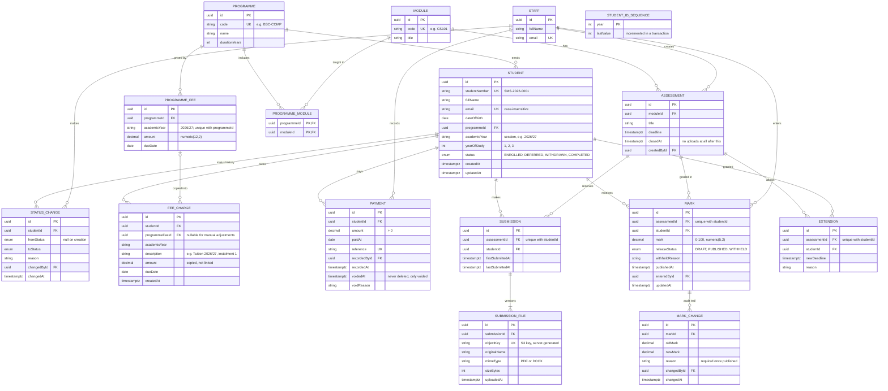

# ER diagram

> **Status: draft.** Assumes the proposed answers in [decisions.md](decisions.md) (DB-009 to DB-014).
> Update this diagram whenever `schema.prisma` changes; the schema is the source of truth once it exists.

A rendered export is in [er-diagram.png](er-diagram.png); re-export it when the diagram changes.

Notation: `||` exactly one, `|o` zero or one, `o{` zero or more, `|{` one or more.
`PK` primary key, `FK` foreign key, `UK` unique.

## Notes

- `EXTENSION` is a stretch goal (DB-014).
- `STUDENT_ID_SEQUENCE` stands alone; it only issues Student IDs (DB-004).
- `MARK` and `SUBMISSION` are not linked directly. Both are keyed on (assessment, student), so a mark can exist
  without a submission, e.g. 0 for work that was never handed in.
- Values such as balance, overdue, late and classification are calculated, not stored — see [README.md](README.md).
