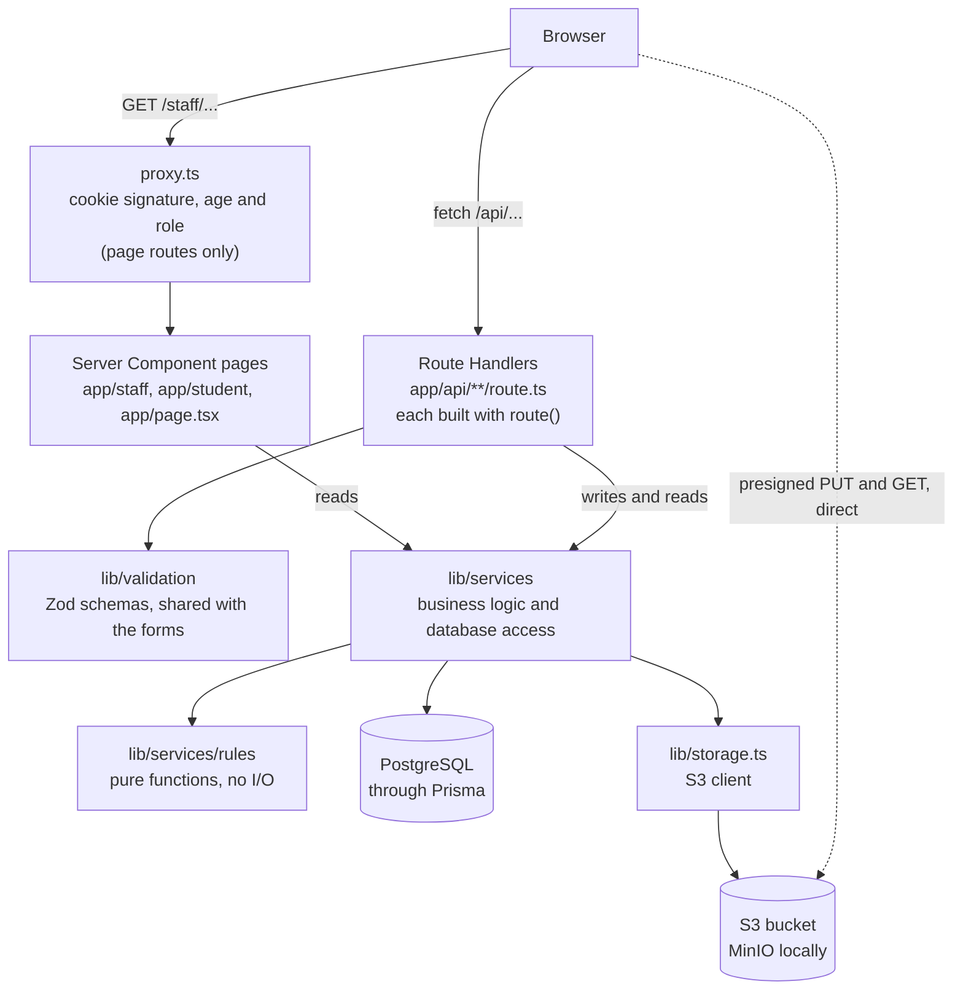
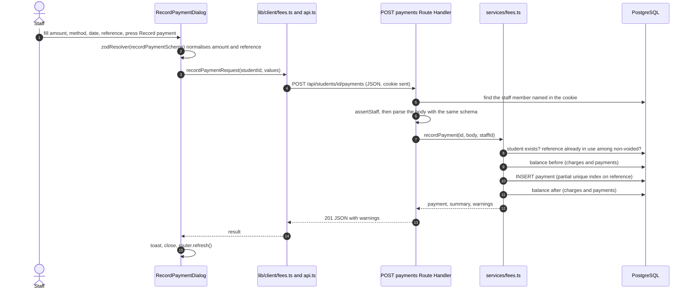
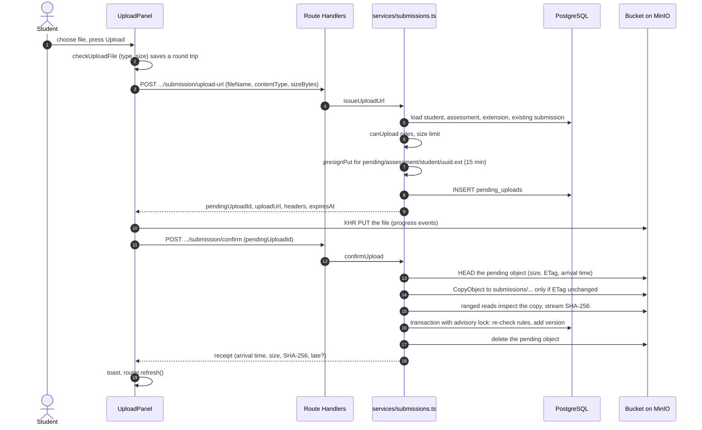
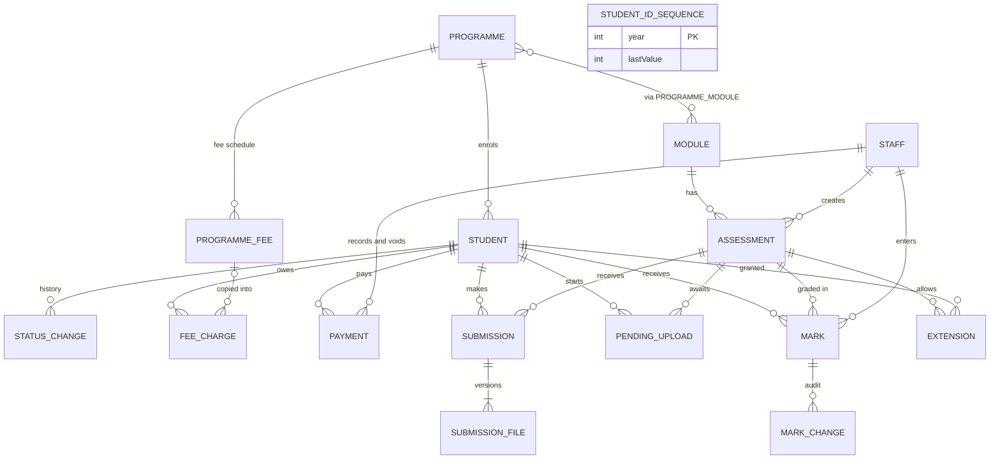
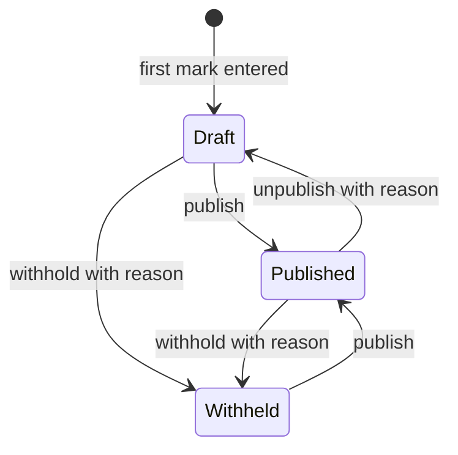
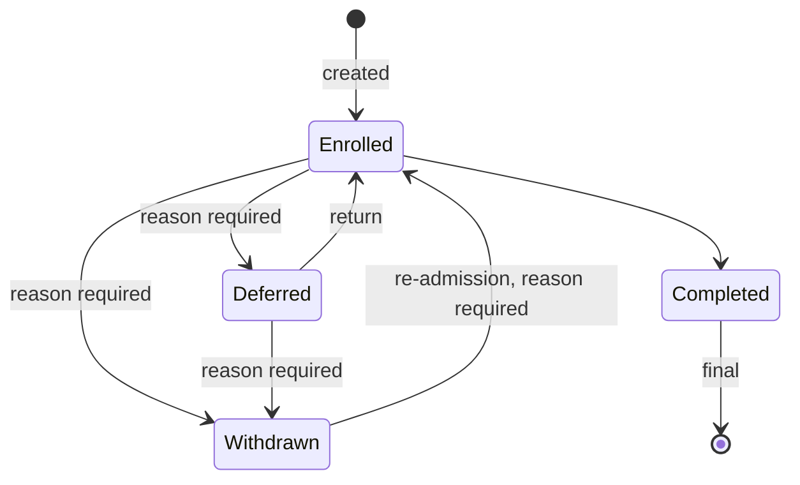
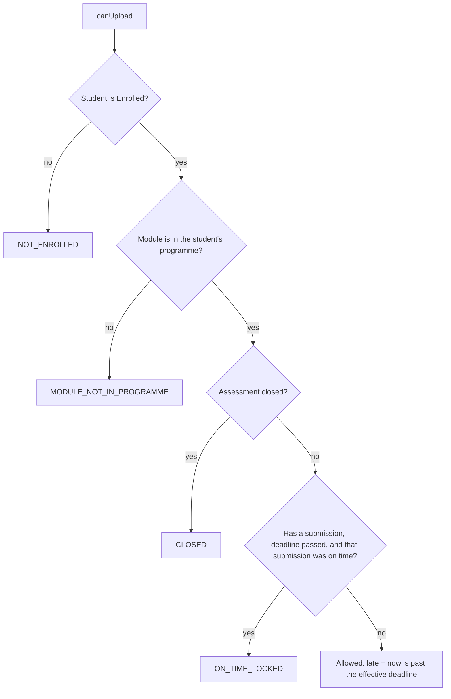
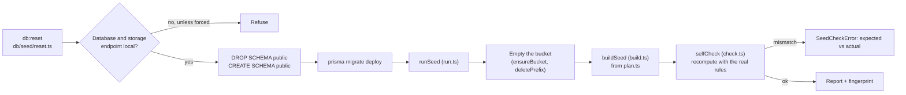

# Onboarding guide: understanding this codebase

This guide is for the person who will submit this project and may have to explain it in an interview. You are assumed to
know TypeScript and React basics, but not to have written (or read) this code. AI agents built it, one milestone at a
time, so the aim here is that you understand it as if you had.

How it was written: every statement was checked against the source files at commit `93bc1d0` (branch `main`, 12 Oct
2026). Where a document and the code disagree, the code wins and the difference is listed under
[Doc drift](#17-doc-drift) at the end. Test counts are quoted from the [README](../README.md); they were not re-run for
this guide.

## How to read this guide

| You have | Read |
| --- | --- |
| 30 minutes | Sections 1, 2 and 4 (the picture and two real requests), then skim 15 (interview questions) |
| 2 hours | Sections 1 to 8 in order, then open the files they link to |
| The night before an interview | Sections 8 (rules cheat-sheet), 14 (gotchas) and 15 (questions), then the decision IDs they cite in [decisions.md](decisions.md) and [db/decisions.md](../db/decisions.md) |

Contents: [1 One page](#1-what-this-is-in-one-page) · [2 Mental model](#2-mental-model) ·
[3 Repository map](#3-repository-map) · [4 A request end to end](#4-a-request-end-to-end) ·
[5 Cross-cutting foundations](#5-cross-cutting-foundations) · [6 Data model](#6-the-data-model) ·
[7 Workflows in depth](#7-each-workflow-in-depth) · [8 Rules cheat-sheet](#8-business-rules-cheat-sheet) ·
[9 UI layer](#9-the-ui-layer) · [10 Demo data](#10-demo-data) · [11 Testing and CI](#11-testing-and-ci) ·
[12 How it was built](#12-how-it-was-built) · [13 Common tasks](#13-common-tasks-how-to-change-things) ·
[14 Gotchas](#14-gotchas) · [15 Interview prep](#15-interview-prep) · [16 Glossary](#16-glossary) ·
[17 Doc drift](#17-doc-drift)

Decision IDs such as D-028 live in [decisions.md](decisions.md); database ones such as DB-019 live in
[db/decisions.md](../db/decisions.md). Cite them in an interview: they record not just what was chosen but what was
rejected.

---

## 1. What this is in one page

**The product.** A Student Management System, Registry module, built as a technical assessment for PEN Global. The
"Registry" is the university office that keeps the official record of students, what they owe, what they have submitted
and what they scored. The brief (summarised in [requirements.md](requirements.md)) asks for four workflows, a Staff view
and a Student view, and is graded on stakeholder understanding (30%), edge-case intuition (30%), technical quality (25%)
and the explanation of AI use (15%).

**The four workflows.**

| Workflow | Staff can | Students can | Heart of the code |
| --- | --- | --- | --- |
| Enrolment | Create and edit students, change status (with a reason where required), search and filter | See their own profile and status | [students.ts](../lib/services/students.ts), [rules/status.ts](../lib/services/rules/status.ts) |
| Fees and payments | Define fee schedules, record payments, add adjustments and waivers, void payments, see overdue ageing | See their charges, payments, balance or credit, and an overdue message | [fees.ts](../lib/services/fees.ts), [rules/fees.ts](../lib/services/rules/fees.ts) |
| Assessment submission | Create, edit, close and reopen assessments; see every submission; download files | Upload a PDF or DOCX, replace it before the deadline, keep a receipt | [assessments.ts](../lib/services/assessments.ts), [submissions.ts](../lib/services/submissions.ts) |
| Marksheet and results | Enter marks 0 to 100 (or "NS"), publish, withhold or unpublish, see history | See published results only | [marks.ts](../lib/services/marks.ts), [rules/marks.ts](../lib/services/rules/marks.ts), [rules/publish.ts](../lib/services/rules/publish.ts) |

On top of those sit a staff **dashboard** (overdue fees with ageing, late submissions, results waiting), a per-student
**activity timeline**, header **quick search** (`Ctrl+K`), **CSV exports** and a print stylesheet.

**Two roles, no login.** The brief makes authentication optional, so a header "Viewing as" menu stands in for it
(D-008, D-020). Choosing a person sets a signed, HTTP-only cookie. The security boundary is the server: every Route
Handler and page re-checks the role, and a student asking for another student's data gets a 404. This is explained in
[5.3](#53-roles-and-the-signed-cookie).

**What "done" looks like.** The deliverables in [requirements.md](requirements.md) are all present: the repo, a README
with run instructions, environment variables and an AI section, a seed with 30 students, 3 programmes and sample marks,
a role toggle, and `schema.prisma`. Beyond the brief: every edge case in [edge-cases.md](edge-cases.md) is ticked except
per-student deadline extensions (D-040), CI runs on every pull request, and hosted deployment (milestone M19) was
deliberately left for later, so the project runs locally in Docker.

**Run it in five commands** (full details, ports and troubleshooting in the README's
[Run locally](../README.md#run-locally)):

```bash
npm ci                    # install; the postinstall hook also generates the Prisma client
cp .env.example .env      # defaults work as they are (PowerShell: Copy-Item .env.example .env)
npm run services:up       # Postgres + MinIO in Docker, then create the private bucket
npm run db:reset          # create tables, seed demo data and files, run the seed self-check
npm run dev               # http://localhost:3000
```

You need Node 24 and Docker running. At `http://localhost:3000` you land on the role picker. Pick **Kamrul Hasan**
(staff) to see the dashboard, or search "Tanvir" and pick Tanvir Hasan to see a student with overdue fees, a late
essay and a withheld result. The README's [demo tour](../README.md#demo-tour) lists which person shows which edge case.

---

## 2. Mental model



Two things to notice in the picture.

1. **Reads and writes take different roads, but meet in the same services.** A Server Component page calls
   `lib/services` directly. A button in the browser calls a Route Handler, which validates and then calls the same
   services (D-005). The graders asked for "working API routes", and sharing one service layer means a rule is written
   once.
2. **File bytes never pass through the app.** The browser talks to the bucket directly with presigned URLs
   (D-013). The app only decides whether a URL may be issued and later inspects what arrived.

Also note that `proxy.ts` guards only page URLs (`/staff/*`, `/student/*`; see its `matcher`). It does not run for
`/api/*`, so every Route Handler must, and does, check the role itself.

### What lives in each layer

| Layer | Folder | Holds | May use | Must not |
| --- | --- | --- | --- | --- |
| Pages and layouts | `app/**/page.tsx`, `layout.tsx` | Server Components that call a page guard, then services, then render components | services, components, page guards | contain business rules |
| Route Handlers | `app/api/**/route.ts` | Thin wrappers: declare access, name the Zod schemas, call one service, convert service warnings | `route()`, validation, services | query the database or hold rules |
| Validation | `lib/validation/*` | Zod schemas for request bodies, queries and forms | pure rules (to reuse messages and parsing) | import server-only code (the browser imports them) |
| Services | `lib/services/*.ts` | Business logic, Prisma queries, transactions, DTO shaping, audit rows | `lib/db`, `lib/storage`, rules, `Clock` | read `process.env` directly (they use `lib/env`) |
| Pure rules | `lib/services/rules/*` | Money, time, fees, deadlines, upload permission, marks, publish preview, status matrix, student numbers | each other only | Prisma, `process.env`, `Date.now()`, `new Date()` with no argument, `fetch`, `server-only` |
| Client helpers | `lib/client/*` | Browser `fetch` wrappers and the `ApiRequestError` type | type-only imports from services | import server modules at runtime |
| Components | `components/*` | UI; "use client" ones call `lib/client/*` | pure rules for formatting, validation schemas | call Prisma or services at runtime |

### The rules for crossing layers

- **Rules never read the clock or the environment.** They receive `now` or `today` as a parameter. This is enforced by a
  test that scans the rule files for forbidden patterns
  ([purity.test.ts](../tests/unit/rules/purity.test.ts)) and by a coverage gate of 95% on the folder
  ([vitest.config.mts](../vitest.config.mts)).
- **Services take a `Clock`.** Almost every service function ends with `clock: Clock = systemClock`
  ([clock.ts](../lib/services/clock.ts)), so tests can pin "now" with `fixedClock`. That file is the one place that reads
  the real clock.
- **Services return DTOs that are already JSON-safe**: money as `"160000.00"` strings, instants as ISO strings, calendar
  dates as `"2026-10-12"`. The same object feeds a Server Component and the API response, which is why components
  accept API-shaped props.
- **Services throw `ApiError` subclasses** ([errors.ts](../lib/api/errors.ts)); the `route()` wrapper converts them to
  HTTP. Pages catch `NotFoundError` and call `notFound()`.
- **"Pure plus wired" pairs.** Anything that must be unit-testable without the Next.js server exists as a pure file plus a
  thin wrapper: [env-schema.ts](../lib/env-schema.ts) / [env.ts](../lib/env.ts), [storage-core.ts](../lib/storage-core.ts) /
  [storage.ts](../lib/storage.ts), [session-cookie.ts](../lib/session-cookie.ts) / [session.ts](../lib/session.ts). The
  wrapper imports `server-only`, which would throw if a test or script imported it. Scripts under `db/` and `scripts/`
  use the pure halves for the same reason.
- **Validation may read the clock** (for example "a payment cannot be dated in the future" calls
  `todayIn(new Date())` in [validation/fees.ts](../lib/validation/fees.ts)). That is a deliberate exception: the rule is
  in `rules/time.ts`, the schema just supplies "now", and the service repeats the check with its injected clock.

---

## 3. Repository map

### Top level

| Path | What it is |
| --- | --- |
| [AGENTS.md](../AGENTS.md) | Guidance for AI agents and humans: stack, doc index, working rules |
| [README.md](../README.md) | Grader-facing: run instructions, env vars, demo tour, AI section, limitations |
| [package.json](../package.json) | Scripts (see README), dependencies, `engines.node` 24.x. `postinstall` runs `prisma generate` |
| [proxy.ts](../proxy.ts) | Next.js 16's renamed middleware: redirects `/staff/*` and `/student/*` without a valid role cookie |
| [instrumentation.ts](../instrumentation.ts), [instrumentation-node.ts](../instrumentation-node.ts) | Run once when the Next.js server starts (not during `next build`): import `lib/env` so a bad `.env` stops the server with a readable list |
| [next.config.ts](../next.config.ts) | Almost empty: `agentRules: false` and the Tailwind loader rule. Cache Components are off (D-026) |
| [tsconfig.json](../tsconfig.json), [eslint.config.mjs](../eslint.config.mjs), [.prettierrc.json](../.prettierrc.json) | Strict TypeScript with `noUncheckedIndexedAccess` and the `@/*` alias; ESLint = Next's core-web-vitals and TypeScript sets, then Prettier last; Prettier with the Tailwind plugin (100 columns) |
| [prisma.config.ts](../prisma.config.ts) | Points Prisma at `db/schema.prisma` and `db/migrations`; uses `DIRECT_URL` else `DATABASE_URL` |
| [docker-compose.yml](../docker-compose.yml) | `postgres` (18.6, creates `sms_test` too), `minio` (pgsty fork), one-shot `minio-init` |
| [vitest.config.mts](../vitest.config.mts), [vitest.integration.config.mts](../vitest.integration.config.mts) | Unit and integration test configs |
| `.env.example` | The only env file that is committed; every variable documented |
| `.github/workflows/ci.yml` | Five CI jobs (see [11](#11-testing-and-ci)) |
| `.claude/agents/` | The `planner` and `coder` agent definitions |

### `app/`: pages and API

| Path | What it holds |
| --- | --- |
| [app/layout.tsx](../app/layout.tsx) | Root layout: fonts, `ThemeProvider`, tooltip provider, demo banner (reads `env.DEMO_MODE` on the server), toaster |
| [app/page.tsx](../app/page.tsx) | The role picker at `/` |
| `app/staff/**` | Staff pages: dashboard, students (list, new, record, edit), fees, programmes, assessments (list, new, detail). [layout.tsx](../app/staff/layout.tsx) adds header and sidebar and calls `requireStaffPage()` |
| `app/student/**` | Student pages: overview, fees, assessments (list, detail), results. [layout.tsx](../app/student/layout.tsx) adds header and tabs and calls `requireStudentPage()` |
| [app/error.tsx](../app/error.tsx), [app/not-found.tsx](../app/not-found.tsx), `loading.tsx` | Error boundary, 404 page, skeletons for `/staff` and `/student` |
| `app/api/**/route.ts` | 38 route files exposing 44 method-and-path handlers. Listed in [api.md](api.md) and in the `EXPECTED_ACCESS` table of [route-access.test.ts](../tests/integration/api/route-access.test.ts) |

### `lib/`: everything that is not UI

| Path | What it holds |
| --- | --- |
| [lib/env-schema.ts](../lib/env-schema.ts), [lib/env.ts](../lib/env.ts) | Zod-validated environment (pure parser, then the server-only singleton) |
| [lib/db.ts](../lib/db.ts) | Prisma client singleton using the `pg` driver adapter; cached on `globalThis` in development |
| [lib/storage-core.ts](../lib/storage-core.ts), [lib/storage.ts](../lib/storage.ts) | S3 wrapper (presign, head, copy, ranged read, SHA-256, delete) and its env-wired facade |
| [lib/session-cookie.ts](../lib/session-cookie.ts), [lib/session.ts](../lib/session.ts), [lib/page-guards.ts](../lib/page-guards.ts) | Cookie signing and verification; identity lookup and `requireStaff()`-style helpers; page redirects |
| [lib/list-params.ts](../lib/list-params.ts) | `page`, `pageSize`, `sort` parsing and URL-building shared by pages and the `DataTable` |
| [lib/csv.ts](../lib/csv.ts), [lib/logger.ts](../lib/logger.ts), [lib/utils.ts](../lib/utils.ts) | CSV encoding, one-line JSON error logging, `cn` helper |
| `lib/api/` | [handler.ts](../lib/api/handler.ts) (`route()`), [errors.ts](../lib/api/errors.ts), [csv-response.ts](../lib/api/csv-response.ts) |
| `lib/validation/` | Zod schemas: `students`, `fees`, `assessments`, `submissions`, `marks`, `programmes`, `timeline`, `session`, plus `dates` and `reason` helpers |
| `lib/client/` | Browser fetch helpers: [api.ts](../lib/client/api.ts), [api-errors.ts](../lib/client/api-errors.ts), and per-area ones (`fees`, `students`, `marks`, `submissions`, ...) |
| `lib/generated/prisma/` | The generated Prisma client. Gitignored; recreated by `postinstall` or `npm run db:generate` |

### `lib/services/`: one file per area

| File | Responsibility |
| --- | --- |
| [students.ts](../lib/services/students.ts) | List and search, create (with ID, status row and fee charges), edit with version, status change |
| [student-number.ts](../lib/services/student-number.ts) | Atomic Student ID allocator (also used by the seed) |
| [fees.ts](../lib/services/fees.ts), [fee-summary.ts](../lib/services/fee-summary.ts) | Fees, payments, voids, adjustments, waivers, balances list; the batch loader that applies the pure fee rule |
| [programmes.ts](../lib/services/programmes.ts) | Programmes, modules, fee schedules (replace a session's schedule) |
| [assessments.ts](../lib/services/assessments.ts) | Assessment list with counts, create/update/close/reopen, per-assessment submissions list |
| [submissions.ts](../lib/services/submissions.ts) | The student upload flow (issue URL, confirm) and the student's own assessment views |
| [file-inspection.ts](../lib/services/file-inspection.ts), [files.ts](../lib/services/files.ts), [upload-cleanup.ts](../lib/services/upload-cleanup.ts) | Look inside a PDF/DOCX; download links; delete abandoned uploads |
| [marks.ts](../lib/services/marks.ts) | Marksheet, enter a mark, publish/withhold/unpublish, staff results, student results |
| [dashboard.ts](../lib/services/dashboard.ts), [timeline.ts](../lib/services/timeline.ts), [exports.ts](../lib/services/exports.ts) | Dashboard figures, activity timeline, CSV exports |
| [me.ts](../lib/services/me.ts), [identity.ts](../lib/services/identity.ts), [health.ts](../lib/services/health.ts) | The student's own profile/overview; staff and student lookup for the role switcher; health probes |
| [clock.ts](../lib/services/clock.ts), [ids.ts](../lib/services/ids.ts) | `Clock`, `systemClock`, `fixedClock`; UUID check (`assertKnownId`) and `dateColumn` |
| `rules/` | Pure rules: `money`, `time`, `fees`, `deadlines`, `submission-rules`, `marks`, `publish`, `status`, `student-number`, `student-profile`, `duplicates`, `types` |

### `components/`

| Path | What it holds |
| --- | --- |
| `components/ui/` | shadcn/ui primitives (button, dialog, field, table, select, tabs, card, command, sheet, ...) |
| `layout/`, `session/`, `theme/` | Header, staff sidebar, student tabs, demo banner, quick search; role picker and switcher; theme provider and toggle |
| `shared/` | `StatusBadge`, `PageHeader`, `EmptyState`, `ErrorState`, `Notice`, skeletons, `FilterSelect`, `ExportCsvButton` |
| `format/` | `Money`, `DateTime`, `RelativeTime`, `Countdown`, file size |
| `data-table/`, `dialogs/` | The URL-driven `DataTable`; `ConfirmDialog` and `ReasonDialog` |
| `students/`, `fees/`, `programmes/`, `assessments/`, `submissions/`, `marks/`, `dashboard/`, `student/` | Components per workflow (`student/` is the student portal's cards and tables) |

### `db/`, `tests/`, `scripts/`, `docker/`, `docs/`

| Path | What it holds |
| --- | --- |
| [db/schema.prisma](../db/schema.prisma) | The data model (source of truth). Companion docs: [README](../db/README.md), [er-diagram.md](../db/er-diagram.md) and its PNG, [decisions.md](../db/decisions.md), [seed-plan.md](../db/seed-plan.md) |
| `db/migrations/` | Five migrations (see [6](#6-the-data-model)); the first contains hand-written SQL |
| `db/seed/` | The seed: `plan.ts` (data), `build.ts`, `check.ts` (self-check), `run.ts`, `reset.ts`, `index.ts`, `timeline.ts`, `rng.ts`, `fixtures/` (sample PDF and DOCX) |
| `db/tools/` | [database.ts](../db/tools/database.ts) (guarded schema drop, `migrate deploy`, local-only guard) and the `uploads:cleanup` command |
| `tests/unit/`, `tests/integration/`, `tests/support/` | Unit and jsdom component tests; real-Postgres-and-MinIO tests; harness, factories, helpers |
| `scripts/` | Browser scripts that drive the installed Chrome: a11y, responsive, keyboard walkthrough, e2e, ER diagram PNG |
| `docker/` | Init scripts: `postgres/init/01-create-test-db.sh`, `minio/init.sh` |
| `docs/` | [requirements](requirements.md), [tech-stack](tech-stack.md), [decisions](decisions.md), [api](api.md), [pages](pages.md), [edge-cases](edge-cases.md), [milestones](milestones.md), [ai-usage](ai-usage.md), [discussions](discussions.md), [todo](todo.md), [code review](code-reviews/code-review-2026-10-12.md), screenshots |

---

## 4. A request, end to end

Two real flows, traced through the actual files. Read them with the code open.

### 4a. Staff records a payment



1. **The dialog** ([record-payment-dialog.tsx](../components/fees/record-payment-dialog.tsx)) is a react-hook-form form
   whose resolver is `zodResolver(recordPaymentSchema)` ([validation/fees.ts](../lib/validation/fees.ts)). The schema
   *transforms* as well as checks: `"1,25,000"` becomes `"125000.00"`, and a reference such as `trx 9f3` becomes
   `TRX 9F3`. The submit handler receives the transformed values. The date defaults to today in Dhaka, and the dialog
   shows an overpayment heads-up as you type (`excessOverBalance`) before anything is sent. The submit button is
   disabled while the request runs, so a double click cannot send it twice.
2. **The client helper** `recordPaymentRequest` ([lib/client/fees.ts](../lib/client/fees.ts)) calls `apiRequest`
   ([lib/client/api.ts](../lib/client/api.ts)), which does `fetch` with a JSON body and turns any error response into an
   `ApiRequestError` carrying `status`, `code`, `details`.
3. **The route file** is a handful of lines:

   ```ts
   export const POST = route<"staff", Params, undefined, RecordPaymentInput>(
     { access: "staff", body: recordPaymentSchema },
     async ({ params, body, identity, warn }) => {
       const { warnings, ...result } = await recordPayment(params.id, body, identity.staff.id);
       for (const warning of warnings) warn(warning.code, warning.message);
       return respond(result, { status: 201 });
     },
   );
   ```

4. **`route()`** ([handler.ts](../lib/api/handler.ts)) does the shared work, in this order: pick a request id; read the
   cookie and look the person up (`identityFromRequest`); reject with 401/403 if the access level is not met; parse the
   query; parse the JSON body with the Zod schema (a failure becomes a 400 with per-field messages); await `params`;
   run the handler; wrap the return value. The role check comes first on purpose, so a student hitting a staff route
   gets 403 whatever they sent (a test proves it).
5. **`recordPayment`** ([fees.ts](../lib/services/fees.ts)) runs these checks in order:
   student exists (a non-UUID id is also a 404); `paidAt` not after today in Dhaka (400 on `paidAt`); reference not
   already used by a non-voided payment (409 `CONFLICT` whose `details.existing` points at the other payment). It reads
   the balance, inserts the row, reads the summary again and adds an `OVERPAYMENT` warning if the amount exceeded the
   balance before. Two details worth knowing:
   - **It is not wrapped in a transaction.** The duplicate check is a convenience; the real guard is the partial unique
     index `payments_reference_active_key` (DB-024). If two identical requests race, the loser's insert fails with
     Prisma error `P2002`, and the service turns that into the same 409:

     ```ts
     } catch (error) {
       // Two identical submissions (a double click) both pass the check above; the unique index lets only one in.
       if (isReferenceClash(error)) {
         const raced = await referenceConflict(input.reference);
         if (raced) throw raced;
       }
       throw error;
     }
     ```

   - **Nothing is stored about balances.** `summaryFor` calls `loadFeeSummaries`
     ([fee-summary.ts](../lib/services/fee-summary.ts)), which loads the student's charges and payments (two queries)
     and runs the pure `feeSummary` rule. See [8](#8-business-rules-cheat-sheet).
6. **The response.** `route()` merges the `warn(...)` calls into a `warnings` array on the body, sets `x-request-id` and
   `Cache-Control: no-store`, and returns `201 { payment, summary, warnings? }`.
7. **Back in the dialog:** a success toast, one warning toast per warning (12 seconds), close the dialog, then
   `router.refresh()`. That re-runs the Server Components on the current page, so the balance, the payments table, the
   dashboard row and the timeline all update without a reload. If the API answered 409 `CONFLICT` with an existing
   payment, the dialog shows an inline alert linking to it; any other error goes through `handleApiError`
   ([api-errors.ts](../lib/client/api-errors.ts)), which puts field messages on the form fields and everything else
   in a toast.

### 4b. A student uploads a submission

Three calls, with the file going straight to the bucket in the middle.



**Step 1: ask for a URL.** [upload-panel.tsx](../components/submissions/upload-panel.tsx) cleans the file name, then
calls `requestUploadUrl` ([lib/client/submissions.ts](../lib/client/submissions.ts)). The route
([upload-url/route.ts](../app/api/assessments/[id]/submission/upload-url/route.ts)) is `access: "student"` with
`uploadUrlSchema`, which strips folder parts from the name, requires `.pdf` or `.docx`, and requires the declared MIME
type to match the extension. `issueUploadUrl` ([submissions.ts](../lib/services/submissions.ts)) then:

- rejects a file larger than `MAX_UPLOAD_MB` (400 on `sizeBytes`);
- loads the student, assessment, the student's extension and any existing submission in one parallel batch, and asks the
  pure `canUpload` rule (422 `BUSINESS_RULE` with `details.rule` = `NOT_ENROLLED`, `MODULE_NOT_IN_PROGRAMME`, `CLOSED`
  or `ON_TIME_LOCKED`);
- builds a **pending key** `pending/<assessmentId>/<studentId>/<uuid>.<ext>`; the file name never enters the key;
- signs a `PUT` for that key that is valid for 15 minutes and covers `Content-Type` and `Content-Length`
  ([storage-core.ts](../lib/storage-core.ts) `presignPut`), so storage itself refuses a different type or size;
- inserts a `pending_uploads` row remembering the declared name, type and size.

**Step 2: the browser uploads.** `uploadToStorage` uses `XMLHttpRequest` (the only browser API with upload progress) to
PUT to the presigned URL, sending exactly the headers the API returned. The browser adds `Content-Length` itself. Nothing
touches the Next.js server.

**Step 3: confirm.** `confirmUpload` is the careful part (D-042, D-043):

1. Find the pending row for this student and assessment (404 otherwise). If it is already confirmed, return the
   existing receipt (idempotent). If it has expired, discard it and answer 422 `UPLOAD_EXPIRED`.
2. `HEAD` the pending object. Missing means 422 `UPLOAD_NOT_FOUND`. Empty, over the limit, or not the declared size
   deletes the object and the row and answers 400 on the `file` field.
3. **Copy, do not trust.** The 15-minute URL can still write the pending key, so the object is copied inside storage to
   a new random **final key** `submissions/<assessmentId>/<studentId>/<uuid>.<ext>` that no URL is ever signed for. The
   copy is conditional on the ETag seen at `HEAD`; a swap in between becomes "The file changed while it was being
   checked".
4. **Inspect and fingerprint the copy**: `inspectUpload` reads a few ranged slices ([file-inspection.ts](../lib/services/file-inspection.ts)),
   and `sha256` streams the object through a hash without holding it in memory. A fake PDF, a macro-enabled DOCX or a
   corrupt ZIP is rejected here by content, not name.
5. **One transaction**, which first takes `pg_advisory_xact_lock(hashtextextended('submission:<assessment>:<student>', 0))`
   so two confirms for the same student and assessment queue up. Inside it: re-read the pending row (already confirmed or
   gone?), re-check the expiry, reload the context and re-run `canUpload` with the **object's arrival time** as "now"
   (D-023), then create or update the `submissions` row, add the next `submission_files.version`, and mark the pending
   row confirmed with its `final_object_key`.
6. After the commit, delete the pending object (a failure is only logged). Return the receipt: file name, size, SHA-256,
   arrival time, `late`, `lateBy`.

Back in the panel: a toast ("File received on time" or "marked late"), the receipt card, and `router.refresh()` so the
version history and status badge come from the server. If the network drops during confirm, the panel tries up to three
times in total, which is safe because confirm is idempotent.

---

## 5. Cross-cutting foundations

These are the pieces every feature leans on. If you understand this section, most of the rest is applying it.

### 5.1 Environment validation

- [env-schema.ts](../lib/env-schema.ts) defines the schema with Zod and `parseEnv(source)`. Empty or whitespace-only
  values count as unset. It reports **one line per bad variable** (the first problem for it, or "is missing") inside an
  `EnvError` whose message ends with "Copy .env.example to .env". Defaults: `S3_FORCE_PATH_STYLE=true`,
  `APP_TIMEZONE=Asia/Dhaka`, `MAX_UPLOAD_MB=20`, `DEMO_MODE=false`; `DIRECT_URL` falls back to `DATABASE_URL`;
  `SESSION_SECRET` must be at least 32 characters; booleans are the strings `"true"` and `"false"`.
- [env.ts](../lib/env.ts) is `export const env = parseEnv(process.env)` behind `import "server-only"`. Server code only;
  a client component importing it would fail the build.
- **When it runs.** [instrumentation.ts](../instrumentation.ts) is Next.js's start-up hook. On the Node runtime, and not
  during `next build`, it imports `lib/env` via [instrumentation-node.ts](../instrumentation-node.ts); if that throws it
  prints just the list of problems and exits with status 1. Without that hook the error would appear on the first request
  instead. `lib/db`, `lib/session`, `lib/storage`, the submissions service and `app/layout.tsx` also import `env`.
- **Scripts** (seed, reset, cleanup) cannot import `server-only` modules, so [db/seed/context.ts](../db/seed/context.ts)
  loads `dotenv/config` and calls `parseEnv` directly.
- `proxy.ts` is the exception: it reads `process.env.SESSION_SECRET` itself (if it is empty, nobody gets in).
- **Dead setting.** `APP_TIMEZONE` is validated but nothing reads it; the zone is the constant `APP_TIME_ZONE` in
  [rules/time.ts](../lib/services/rules/time.ts) (see [Doc drift](#17-doc-drift)).

### 5.2 The `route()` wrapper, errors and warnings

Every Route Handler is `export const GET = route({ access, query?, body? }, handler)`
([handler.ts](../lib/api/handler.ts)). The wrapper does everything that must never be forgotten:

| Step | What happens |
| --- | --- |
| 1 | Pick a request id: reuse an incoming `x-request-id` if it matches `^[\w.-]{1,64}$`, else a random UUID |
| 2 | Resolve the identity from the cookie (skipped for `access: "public"`) and apply the access level |
| 3 | Parse the query string (repeated keys become arrays), then the JSON body, with the Zod schemas; failure is a 400 |
| 4 | Await the dynamic `params` (in Next.js 15+ they are a Promise) |
| 5 | Call the handler with `{ request, requestId, params, query, body, identity, warn }` |
| 6 | Convert the result and any thrown error to a `Response` |

| `access` | `identity` is | No valid session | Wrong role | Examples |
| --- | --- | --- | --- | --- |
| `public` | `null` (cookie not even read) | allowed | n/a | `/api/health`, `PUT`/`DELETE /api/session`, `/api/session/options` |
| `optional` | identity or `null` | allowed | n/a | `GET /api/session` |
| `any` | staff or student | 401 | n/a | file download, `GET /api/programmes`, `GET /api/modules` |
| `staff` | staff | 401 | 403 | nearly everything under `/api/students`, `/api/fees`, `/api/assessments` |
| `student` | student | 401 | 403 | `/api/me*`, `upload-url`, `confirm` |

The handler's return value becomes a 200 JSON response; `undefined` becomes 204; `respond(body, { status, headers,
cookies })` sets a status or `Set-Cookie`; returning a `Response` (the CSV exports) passes through with only the request
id added. `warn(code, message, details?)` collects warnings that are added to the body as `warnings` (object bodies only).
Every JSON response carries `x-request-id` and `Cache-Control: no-store`.

**Error classes** ([errors.ts](../lib/api/errors.ts)). Services throw them; the wrapper turns each into
`{ "error": { "code", "message", "details"? } }`. Anything that is not an `ApiError` is logged and answered with a generic
500 whose `details.requestId` the user can quote.

| Class | HTTP | `code` | Typical cause |
| --- | --- | --- | --- |
| `ValidationError` | 400 | `VALIDATION_ERROR` | Zod failure; `details.fieldErrors` (dotted paths) and `formErrors`. `ValidationError.field(name, msg)` for one field from service code |
| `UnauthenticatedError` | 401 | `UNAUTHENTICATED` | No valid role cookie |
| `ForbiddenError` | 403 | `FORBIDDEN` | Valid session, wrong role |
| `NotFoundError` | 404 | `NOT_FOUND` | Missing record, malformed id, or a record that belongs to another student |
| `ConflictError` | 409 | `CONFLICT` | Taken email or payment reference; `details.existing` points at the other record |
| `VersionConflictError` | 409 | `VERSION_CONFLICT` | Optimistic lock failed; `details.currentVersion` |
| `DuplicateWarning` | 409 | `DUPLICATE_WARNING` | Probable duplicate student; resend with `confirmDuplicate: true` |
| `BusinessRuleError` | 422 | `BUSINESS_RULE` | Valid input, forbidden by a rule; `details.rule` names it (`STATUS_TRANSITION`, `CLOSED`, `ON_TIME_LOCKED`, `PAYMENT_ALREADY_VOIDED`, ...) |
| (anything else) | 500 | `INTERNAL_ERROR` | A bug or an outage |

A warning is a success that deserves attention, for example `OVERPAYMENT`, `WAIVER_EXCEEDS_BALANCE`,
`PROGRAMME_CHANGED`, `NO_FEE_SCHEDULE`, `DEADLINE_IN_PAST`, `LATE_FLAGS_RECALCULATED`, `EXISTING_CHARGES_UNCHANGED`,
`OVERDUE_FEES`, `MISSING_MARKS`. The pattern "warn, never block" is a product decision (DB-012, D-033).

**The browser mirrors this.** `apiRequest` throws `ApiRequestError` with `status`, `code`, `details`, and getters
`fieldErrors`, `formErrors`, `requestId`; a dropped connection is code `NETWORK_ERROR`. `handleApiError`
([api-errors.ts](../lib/client/api-errors.ts)) is the single place that decides what a failure looks like to the user:
400 field messages go onto the matching form fields (focusing the first), 401 shows "Your session has ended", a 500 shows
the message plus "Reference: <request id>", everything else is a toast. A caller lists codes it handles itself in
`passthrough` (for example `VERSION_CONFLICT`).

### 5.3 Roles and the signed cookie

[session-cookie.ts](../lib/session-cookie.ts) is pure and holds the whole format:

- Cookie `sms_role` = `<payload>.<signature>`, both base64url. Payload is JSON `{ r: "staff"|"student", id: <uuid>,
  iat: <unix seconds> }`; signature is HMAC-SHA256 of the payload with `SESSION_SECRET`, compared with
  `timingSafeEqual`.
- Valid for 7 days (`Max-Age`), with 60 seconds of tolerance for a clock slightly ahead. Attributes: `Path=/`,
  `HttpOnly`, `SameSite=Lax`, plus `Secure` when `NODE_ENV=production`.
- `verifySessionCookie` returns `{ ok: true, claims }` or a reason (`missing`, `malformed`, `bad-signature`, `expired`,
  `not-yet-valid`). Callers treat every reason as "no session".

[session.ts](../lib/session.ts) adds the database: `lookupIdentity` loads the staff member or student the cookie points at,
so **a cookie for a record that no longer exists is the same as no cookie**.

**Who checks what.** Security does not rest on any one layer:

| Layer | Function | Checks | On failure |
| --- | --- | --- | --- |
| [proxy.ts](../proxy.ts) | `proxy()` | Signature, age, and that the role matches the area (`/staff` needs staff, `/student` needs student). No database | Redirect to `/` |
| Layouts and pages | `requireStaffPage()` / `requireStudentPage()` ([page-guards.ts](../lib/page-guards.ts)) | The above plus the record still exists | Redirect to `/` |
| Route Handlers | `route({ access })` | Same lookup, then the access level | 401 / 403 JSON |
| Services | Student-facing functions take `studentId` from the session identity, never from the request | A student can only reach their own rows | 404 |

Every data page calls its own guard because layouts do not re-run on client navigation (D-031). `proxy.ts` is only the cheap
first filter:

```ts
const AREA_ROLE: Record<string, SessionRole> = { staff: "staff", student: "student" };

export function proxy(request: NextRequest) {
  const area = request.nextUrl.pathname.split("/")[1] ?? "";
  const required = AREA_ROLE[area];
  if (!required) return NextResponse.next();
  const secret = process.env.SESSION_SECRET ?? "";
  const verified = secret
    ? verifySessionCookie(request.cookies.get(SESSION_COOKIE_NAME)?.value, secret)
    : null;
  if (verified?.ok && verified.claims.role === required) return NextResponse.next();
  return NextResponse.redirect(new URL("/", request.url));
}
```

**Switching identity.** The role picker and header switcher call `PUT /api/session` with `{ role, staffId | studentId }`.
The handler checks that the record exists (404 otherwise, no cookie set), then sends `Set-Cookie`. The client then
`router.push`es to `/staff` or `/student` and calls `router.refresh()` so every Server Component re-reads the new
identity ([use-switch-identity.ts](../components/session/use-switch-identity.ts)). "Change role" calls
`DELETE /api/session`. `GET /api/session` always answers 200 (`{ role: null }` when there is no session).

**How "another student's data" is kept out.** Student endpoints derive the student from the cookie and filter by it. A
file that belongs to someone else, or an assessment outside the student's programme that they never submitted to, answers
**404, not 403**, so the response never confirms that it exists (api.md "Roles and access"). Two tests keep this
honest: [route-access.test.ts](../tests/integration/api/route-access.test.ts) discovers every `route.ts` and fails if a
new one is not in its reviewed list, and [student-access.test.ts](../tests/integration/api/student-access.test.ts) aims
every student endpoint at a peer's and a stranger's ids.

**Be ready to say the limit out loud:** there is no real authentication. Anyone who can reach the app can choose Staff.
That is the documented trade-off for a demo (D-008); the signed cookie and server checks show the access-control design
without a login.

### 5.4 Optimistic locking with `version`

Three tables carry `version Int @default(1)`: `students`, `assessments`, `marks` (DB-016). The client sends the version it
read; the update is conditional on it. From `updateAssessment`:

```ts
const updated = await tx.assessment.updateMany({
  where: { id, version: input.version },
  data: { ...data, version: { increment: 1 } },
});
if (updated.count === 0) {
  const now = await tx.assessment.findUnique({ where: { id }, select: { version: true } });
  throw new VersionConflictError(now?.version ?? input.version + 1);
}
```

- The service first compares `current.version !== input.version` (a quick 409), then repeats the check inside the
  conditional write to close the race window.
- What bumps a version: a real profile edit or status change on a student; an assessment edit, close or reopen; a mark
  change, publish, withhold or unpublish (those raw SQL statements do `version = version + 1`). **An edit that changes
  nothing neither writes nor bumps** (students, assessments, and a mark entered with its stored value).
- First-time mark entry has no version. If two people create the same mark at once, the loser hits the unique index and
  gets a `VersionConflictError` carrying the winner's version.
- The UI handles it per screen: the student form, the assessment form and the status dialog show an alert titled "This
  record changed since you opened it" with a reload; a marksheet row shows "Not saved. Changed by someone else since you
  opened this page." with a "Reload this row" button.

### 5.5 Money

- Stored as `numeric(12,2)` (marks as `numeric(4,1)`); never a float (DB-002). Computed with `decimal.js`, re-exported from
  [rules/money.ts](../lib/services/rules/money.ts). Prisma's `Decimal` is accepted through a structural `DecimalLike`
  type, which keeps the rules free of the generated client.
- On the wire: a two-decimal **string** (`"160000.00"`) via `toApiString` (half-up). Inputs must be strings too (the
  schema complains if you send a number).
- `parseMoneyInput` accepts what people type: `125000`, `1,25,000.50`, `125,000`, `৳1,25,000`, `BDT 5,000`, `Tk. 500`. It
  rejects negatives, more than two decimals, bad grouping and anything above `9,999,999,999.99`.
- `formatBdt(125000)` is `৳1,25,000.00`; a negative is `-৳1,25,000.00`. **Lakh grouping and month names are hand-written**
  because Node 24's ICU cannot produce that exact format (D-028); unit tests cover it.
- A waiver is stored as a negative charge; an adjustment is positive; a payment is positive. Check constraints enforce
  the signs ([6](#6-the-data-model)).
- The `Money` component renders `formatBdt` in a `tabular-nums` span. CSV exports use plain `40000.00` so spreadsheets can
  add them up.

### 5.6 Time

- **Stored in UTC, shown in Asia/Dhaka** (D-018, DB-006). Moments (`deadline`, `uploadedAt`, audit times) are
  `timestamptz(3)`. Calendar dates (`dateOfBirth`, `dueDate`, `paidAt`) are Postgres `date`; Prisma returns them as a
  `Date` at UTC midnight, so the code always reads them with `toDateOnly` (UTC parts) and writes them with `dateColumn`
  (`new Date("2026-10-12T00:00:00.000Z")`). Reading such a value as a local-zone instant is the classic off-by-one-day bug,
  which is why the two types are kept apart.
- [rules/time.ts](../lib/services/rules/time.ts) never touches the machine's clock or zone: `zonedParts` uses `Intl` with
  an explicit `timeZone`, and every function takes `now` or a date. Consequently the unit tests pass under both `TZ=UTC`
  and `TZ=America/New_York` (CI runs both).
- Key helpers: `todayIn(now)` is the Dhaka calendar date; `daysBetween(a, b)` counts whole calendar days;
  `zonedTimeToInstant({date, time})` turns a staff member's "23:59 on 11 Oct" into the UTC instant that is stored (and
  throws for a time that does not exist in the zone); `instantToLocalDateTime` is the inverse for edit forms.
- **Academic sessions** run July to June (DB-015): `sessionStartYear` is `month >= 7 ? year : year - 1` judged in Dhaka;
  `sessionLabel(2026)` is `2026-27`; 30 Jun 2026 is session `2025-26` and 1 Jul 2026 is `2026-27`.
- **Formatting is hand-written too**: `11 Oct 2026`, `11 Oct 2026, 23:59`, "2 days", "5 hours" (largest whole unit,
  rounded down), "in 2 days" / "3 days ago".
- **The injectable clock.** Services take `clock: Clock = systemClock`. Pages that need one consistent "now" capture it once
  and pass both the `Date` and its ISO string down (for example the staff assessment page), so server and browser render
  the same text and hydration does not mismatch.

### 5.7 Logging and request ids

[logger.ts](../lib/logger.ts) has one function, `logError(message, error, fields)`, which prints one JSON line to stderr
(`level`, `time`, `message`, the fields, and `error` with name, message and stack). The wrapper uses it for unhandled
errors together with `requestId`, `method` and `path`; the health check and the upload code use it for failures that must
not break the request (a failed storage delete, a dependency that is down). The same request id is in the response header,
in the 500 body and in the log line, which is how you correlate a user's "Reference: abc" with a stack trace. There is no
other logging, and the Definition of Done forbids `console.log` in app code.

### 5.8 The concurrency toolbox

Registry data is edited by several people at once, so almost every write names its protection. This table is an interview
favourite.

| Problem | Tool | Where |
| --- | --- | --- |
| Two students get the same Student ID | One atomic `INSERT ... ON CONFLICT DO UPDATE ... RETURNING` on the year's row, in the same transaction that creates the student (rollback also rolls back the number, so no gaps); unique index as the final net | [student-number.ts](../lib/services/student-number.ts) |
| Same payment reference twice (double click) | Disabled submit button, pre-check, and the partial unique index; a `P2002` is turned into the same 409 | [fees.ts](../lib/services/fees.ts) |
| Lost update on a student, assessment or mark | `version` and a conditional `updateMany` | [students.ts](../lib/services/students.ts), [assessments.ts](../lib/services/assessments.ts), [marks.ts](../lib/services/marks.ts) |
| Two voids, two closes, two reopens | Conditional `updateMany` (`voidedAt: null`, `closedAt: null`); count 0 becomes a 422 rule error | `voidPayment`, `closeAssessment`, `reopenAssessment` |
| Two confirms of one upload | `pg_advisory_xact_lock` per student and assessment, idempotent re-read inside the transaction, a unique final key per attempt | [submissions.ts](../lib/services/submissions.ts) |
| Two publishes or withholds on the same marks | One `UPDATE ... WHERE release_status ... RETURNING id`; history rows are written only for the ids returned | [marks.ts](../lib/services/marks.ts) |
| Two edits to one programme's fee schedules | `SELECT ... FOR UPDATE` on the programme row | [programmes.ts](../lib/services/programmes.ts) |
| Two people create the same email | Pre-check, unique index, then a re-check after `P2002` | [students.ts](../lib/services/students.ts) |
| Cleanup deletes a file that is being confirmed | Cleanup only touches `pending/` keys, waits 10 minutes after expiry, and confirm re-checks expiry inside its transaction | [upload-cleanup.ts](../lib/services/upload-cleanup.ts) |

---

## 6. The data model

[schema.prisma](../db/schema.prisma) is the source of truth; [er-diagram.md](../db/er-diagram.md) is the annotated
diagram (also as [a PNG](../db/er-diagram.png)). Naming: PascalCase singular models map to plural snake_case tables
(`Student` is `students`), camelCase fields to snake_case columns (DB-022). Primary keys are database-generated UUIDs;
business identifiers (`studentNumber`, `code`, payment `reference`) are separate unique columns (DB-001).



(Staff also link to `status_changes`, `fee_charges` and `mark_changes` as the actor; omitted for readability.)

### The tables, grouped by workflow

| Group | Table | What it holds, and the details worth remembering |
| --- | --- | --- |
| Reference | `programmes` | `code` (e.g. `BSC-CSE`), `name`, `duration_years` (caps a student's year of study) |
| | `programme_fees` | One row per instalment of a session's schedule: `academic_year`, `instalment`, `amount`, `due_date`; unique on (programme, year, instalment) |
| | `modules`, `programme_modules` | Modules shared between programmes (many-to-many, DB-013). The join table is the only one that cascades on delete |
| | `staff` | Registry staff (seeded; there is no staff management UI) |
| Enrolment | `students` | Profile plus `status`, `academic_year` (the session, e.g. `2026-27`), `year_of_study` (1, 2, 3...) (DB-009), `version` |
| | `student_id_sequences` | `year` and `last_value`; the counter behind `SMS-<year>-<seq>` |
| | `status_changes` | Every status change including creation (`from_status` is null for creation), with `reason` and who |
| Fees | `fee_charges` | Programme fees, adjustments and waivers (`kind`); `programme_fee_id` links back to the schedule row they were copied from; `created_by_id` |
| | `payments` | Amount, `method` (`BANK_TRANSFER`, `CASH`, `BKASH`, `NAGAD`, `CARD`), `paid_at` date, normalised `reference`, who recorded it, and void columns |
| Assessments | `assessments` | `module_id`, `title`, `deadline`, `closed_at` (no uploads at all once set), `version` |
| | `extensions` | Per-student deadline overrides (DB-014). The rules and reads honour them, but nothing in the app creates one (D-040) |
| | `pending_uploads` | A 15-minute upload slot: `object_key` (pending), `final_object_key` (set at confirm), declared name, type and size, `expires_at`, `confirmed_at` |
| | `submissions` | One row per (assessment, student) with first and last arrival times |
| | `submission_files` | One row per uploaded version: `version` (1, 2, 3...), `object_key`, name, type, size, `sha256`, `uploaded_at` |
| Marks | `marks` | One row per (assessment, student): `mark` (null for NS), `is_non_submission`, `release_status` (`DRAFT`, `PUBLISHED`, `WITHHELD`), `withheld_reason`, `published_at`, `version` |
| | `mark_changes` | History of `MARK`, `PUBLISH`, `WITHHOLD`, `UNPUBLISH` events with old/new mark, reason and who |

Notice that **`marks` and `submissions` are not linked to each other**; both are keyed on (assessment, student) and joined
in code. That is why a student can have a mark without a submission (a non-submission) and why the marksheet merges lists.

### What the database enforces itself

Application code validates first, but the database is the last line of defence. Most of this lives in the first
migration's hand-written SQL, because Prisma cannot express it.

| Constraint | Meaning |
| --- | --- |
| `payments_amount_positive_check` | A payment is above zero; corrections are made by voiding (DB-005) |
| `fee_charges_amount_sign_check` | A `WAIVER` is negative, a `PROGRAMME_FEE` or `ADJUSTMENT` is positive |
| `marks_mark_range_check` | A mark is null or between 0 and 100 |
| `marks_non_submission_check` | `mark IS NULL` exactly when `is_non_submission` |
| `payments_voided_pair_check` | `voided_at` and `voided_by_id` are both set or both null (migration 2) |
| `payments_reference_active_key` | **Partial unique index**: `reference` is unique only `WHERE voided_at IS NULL`, so a voided payment frees its reference (DB-024). Declared in the schema with `@@unique(..., where: raw(...))`, which needs the `partialIndexes` preview feature |
| Unique (`assessment_id`, `student_id`) | One submission, one mark and one extension per student per assessment |
| Unique (`submission_id`, `version`) | File versions are numbered without gaps or repeats |
| Unique `object_key`, `final_object_key` | No two rows point at the same stored file |
| Unique `student_number`, `email`, programme and module `code`, (`programme_id`, `academic_year`, `instalment`) | Business identifiers |
| `ON DELETE RESTRICT` on every foreign key except `programme_modules` | Nothing financial or academic can be deleted by accident (DB-005) |
| Extensions `unaccent` and `pg_trgm`, function `immutable_unaccent(text)`, GIN index `students_full_name_search_idx` | Fast accent- and case-insensitive partial name search (DB-021) |

`immutable_unaccent` exists because Postgres's `unaccent()` is only `STABLE` and so cannot be used in an index. The wrapper
pins the dictionary and is declared `IMMUTABLE`. The search code must use **exactly** that expression, which it does:
`immutable_unaccent(lower(s.full_name)) LIKE immutable_unaccent(lower($1)) ESCAPE '!'` ([students.ts](../lib/services/students.ts)
and [identity.ts](../lib/services/identity.ts)).

What the database does **not** enforce, and services do instead: status transitions, "a reason is required" (DB-022),
the version check, upload rules and sizes, email lower-casing (done by Zod), the session label format, the date-of-birth range.

### What is derived and never stored (DB-003)

| Value | Computed by | From |
| --- | --- | --- |
| Balance, credit, overdue amount, oldest overdue days, ageing bucket, next due date, fee state | `feeSummary` | Charges and non-voided payments |
| Effective deadline, late flag, "late by" | `effectiveDeadline`, `isLate`, `lateBy` | Assessment deadline, optional extension, latest file's arrival time |
| Assessment state (open, past deadline, closed) | `assessmentState` | Deadline, `closed_at`, now |
| Classification (Fail, Pass, Merit, Distinction) | `classify` | The mark, rounded half-up |
| Who is on a marksheet / eligible for an assessment | `eligibleStudentWhere` and friends | Student status, programme modules, submissions |

Because nothing is stored, changing a deadline, voiding a payment or adding a waiver takes effect everywhere immediately,
and there is no copy that can drift.

### Audit and history

| Evidence | Where |
| --- | --- |
| Status history | `status_changes` (written on creation and on every change) |
| Who recorded, who voided, and why | `payments.recorded_by_id`, `voided_by_id`, `voided_at`, `void_reason` (a payment is never edited or deleted) |
| Who added a charge | `fee_charges.created_by_id` (automatic programme-fee charges record the staff member who enrolled the student) |
| Mark and release history | `mark_changes` (the first entry of a mark writes no row; later changes and release events do, DB-023) |
| Every file version and its receipt | `submission_files` (never overwritten or deleted) |

The activity timeline ([7.7](#77-timeline-quick-search-exports-and-print)) is built entirely from these. Note that editing
a student's profile fields (name, email, programme...) is **not** audited; only status changes are.

### Migrations

All five are in [db/migrations](../db/migrations). `prisma migrate deploy` applies them in order; CI applies them twice
to an empty database and then checks for drift against the schema.

| Migration | What and why |
| --- | --- |
| `20261011191958_init` | Whole schema, plus hand-written SQL: extensions, `immutable_unaccent`, trigram index, four check constraints |
| `20261012120000_fee_audit_columns` | `fee_charges.created_by_id`, `payments.voided_by_id`, the voided-pair check, the partial unique index (DB-024) |
| `20261012180000_pending_upload_details` | `original_name`, `mime_type`, `size_bytes` on `pending_uploads` (DB-025); deletes leftover throw-away rows first |
| `20261012200000_submission_last_submitted_index` | Index on `submissions.last_submitted_at` for the dashboard's 14-day window (DB-026) |
| `20261013090000_confirmed_file_keys_and_versions` | `pending_uploads.final_object_key` and `submission_files.version`, with a backfill (DB-027) |

---

## 7. Each workflow in depth

Each subsection lists the moving parts, then the rules and the edge cases they handle, then the tests. Rules are stated
here in prose and collected as formulas in [section 8](#8-business-rules-cheat-sheet).

### 7.1 Enrolment

| Layer | Where |
| --- | --- |
| Rules | [status.ts](../lib/services/rules/status.ts) (matrix), [duplicates.ts](../lib/services/rules/duplicates.ts), [student-profile.ts](../lib/services/rules/student-profile.ts) (date of birth, session label), [student-number.ts](../lib/services/rules/student-number.ts) |
| Validation | [validation/students.ts](../lib/validation/students.ts) (form, create, PATCH, status and list-query schemas) |
| Service | [students.ts](../lib/services/students.ts): `listStudents`, `createStudent`, `getStudent`, `updateStudent`, `changeStatus`, `listProgrammeOptions`, `listAcademicYears`; [student-number.ts](../lib/services/student-number.ts) |
| Routes | `GET`/`POST /api/students`, `GET`/`PATCH /api/students/[id]`, `POST /api/students/[id]/status` |
| Pages | `/staff/students` (list), `/new`, `/[id]` (record), `/[id]/edit` |
| Components | `students-table`, `student-filters`, `student-form`, `duplicate-dialog`, `status-change-dialog`, `fee-status` in `components/students/` |

**Creating a student** (`createStudent`). The checks run in a fixed order so the user sees the most useful error first:
date of birth, then programme exists and the year of study fits the programme's length, then a taken email (409
`CONFLICT` with the existing student), then a probable duplicate (409 `DUPLICATE_WARNING` listing the matches) unless
`confirmDuplicate: true`. Then **one transaction** does four things: allocate the next Student ID, insert the student,
insert the first `status_changes` row (`from_status` null, `ENROLLED`), and insert one `PROGRAMME_FEE` charge per
instalment of the programme's fee schedule for the chosen session (copying amount and due date, described as
`Tuition 2026-27` or `Tuition 2026-27, instalment 2`). If the programme has no schedule for that session the student is
still created, with a `NO_FEE_SCHEDULE` warning. A race on the same email is caught as a unique violation and reported as
the same friendly 409.

Edge cases handled, and where:

| Edge case | Handling |
| --- | --- |
| Same person entered twice | Same normalised name (case, accents, extra spaces ignored) and same date of birth, any status. Warning dialog lists matches with "Create anyway". Withdrawn students match too, because the right fix is re-admission |
| Impossible date of birth | Real calendar date, not in the future, age 16 to 100 on today's Dhaka date (the day someone turns 16 is accepted; turning 101 is the first rejected) |
| Year of study | 1 to 8 in the schema, and not above the programme's `durationYears` in the service |
| Email | Trimmed and lower-cased by the schema, unique at the database (DB-007) |
| Name | Trimmed, 2 to 120 characters, runs of spaces collapsed |
| Student ID year | The start year of the **session chosen on the form**, not today's date (DB-015, D-032) |
| Programme change | Allowed on edit; existing charges are not touched and a `PROGRAMME_CHANGED` warning says to add an adjustment or waiver if fees differ |
| Edit that changes nothing | Returns the record without writing or bumping `version` |
| Two staff editing | `version` check, 409 `VERSION_CONFLICT` (see [5.4](#54-optimistic-locking-with-version)) |
| Status change | Allowed transitions only; some need a reason; check order is version (409), transition (422), reason (400 on `reason`). A same-status request is also a 422 |

**Listing and search.** Search, filters, sorting and paging run in SQL, with one exception. The default status filter is
Enrolled and Deferred, so Withdrawn and Completed are hidden until a status filter includes them. `q` matches the name with
the indexed `immutable_unaccent(lower(full_name))` expression, and the Student ID or email as a case-insensitive
substring (`0007` finds `SMS-2026-0007`); `%` and `_` are escaped so they match literally. Sorting always ends with
Student ID then id, so pages never repeat or skip a row. The **fee-state filter** (overdue, outstanding, credit, paid) is
applied in memory: SQL returns the ids in order, the pure `feeSummary` rule runs over their charges and payments, and the
page is sliced afterwards. That keeps one definition of "overdue" (D-032); the cost is that it reads every matching
student's charges, fine for thousands of students and a candidate for a SQL view beyond about 10,000.

**Where it is tested.** [students.test.ts](../tests/integration/api/students.test.ts) (ID format and concurrent allocation,
email conflict, duplicates, date of birth, every cell of the status matrix, version conflicts, search, default hiding),
[student-number.test.ts](../tests/integration/db/student-number.test.ts) (20 simultaneous creations give 20 distinct,
gap-free numbers), the page tests under `tests/integration/pages/`, the pure rules under `tests/unit/rules/` and the
form, dialog and filter tests under `tests/unit/ui/`.

### 7.2 Fees and payments

| Layer | Where |
| --- | --- |
| Rules | [fees.ts](../lib/services/rules/fees.ts) (`feeSummary`, ageing, `overdueNotice`), [money.ts](../lib/services/rules/money.ts) |
| Validation | [validation/fees.ts](../lib/validation/fees.ts), [validation/programmes.ts](../lib/validation/programmes.ts) |
| Service | [fees.ts](../lib/services/fees.ts), [fee-summary.ts](../lib/services/fee-summary.ts), [programmes.ts](../lib/services/programmes.ts) |
| Routes | `GET /api/students/[id]/fees`, `POST .../charges`, `POST .../payments`, `POST /api/payments/[id]/void`, `GET /api/fees`, `GET /api/programmes`, `GET`/`PUT /api/programmes/[id]` and `/fees/[academicYear]`, `GET /api/modules` |
| Pages | The Fees card on the student record; `/staff/fees`; `/staff/programmes` |
| Components | `components/fees/` (record-payment-dialog, charge-dialog, void-payment-button, charges/payments/balances tables, fee-summary-strip, badges), `components/programmes/` |

**The model in one paragraph.** A programme has a fee schedule per session (one or more instalments, each an amount and a
due date). At enrolment those rows are **copied** into the student's `fee_charges`; after that the student's charges live
their own life, so editing a schedule never changes existing charges (and removing an instalment that students have been
billed for is refused with `FEE_INSTALMENT_IN_USE`). Payments are **not linked to particular charges**: they are applied to
the oldest charge first (D-028), which is how student accounts are normally settled and needs no allocation screen.
Adjustments add to what is owed; waivers (stored negative) reduce it.

Rules and edge cases:

- **Recording a payment** (`recordPayment`): amount above zero with at most two decimals; method is one of five (bKash and
  Nagad included, DB-018); `paidAt` today or earlier in Dhaka (backdating allowed, future blocked); a reference is required
  even for cash (the dialog relabels it "Receipt number"). References are stored trimmed, with spaces collapsed and
  upper-cased, and are unique among **non-voided** payments, so `trx 9f3` and `TRX 9F3` are the same reference.
- **Overpayment** is allowed with an `OVERPAYMENT` warning, including when the student owes nothing; the excess shows as
  credit, never as a negative balance.
- **Voiding** (`voidPayment`) requires a reason of 1 to 500 characters, records who and when, keeps the row, and frees the
  reference. It is one conditional `UPDATE ... WHERE voided_at IS NULL`, so of two simultaneous voids exactly one wins and the
  other gets `PAYMENT_ALREADY_VOIDED`. Payments are never edited or deleted.
- **Adjustments and waivers** (`addCharge`) are allowed for a student of any status (a withdrawn student's account may need
  correcting), belong to the student's current session, and may have a due date in the past (due at once). A waiver larger
  than the balance is allowed with `WAIVER_EXCEEDS_BALANCE`; the rest becomes credit.
- **Saving a fee schedule** (`replaceFeeSchedule`) takes a row lock on the programme, matches instalments by number
  (1..n, 1 to 12 of them), updates in place or adds, and removes only instalments nobody was billed for. When something
  changed and students were already billed it answers `EXISTING_CHARGES_UNCHANGED`.
- **`GET /api/fees`** (`listBalances`) lists every student whose fee state is not "paid", **whatever their enrolment
  status**: a withdrawn student who still owes stays on the overdue list. Default sort is longest overdue first. The
  `ageingBucket=60+` filter has a small repair for a hand-typed `+` (which a query string turns into a space).
- **What the student sees** (`getMyFees`): their charges (waivers as negative amounts), non-voided payments, balance or
  credit, next due date, and the sentence "Overdue by N days. Please contact the Registry office." They do not get the
  ageing bucket, staff names, voided payments or internal timestamps.

**Where it is tested.** [fees.test.ts](../tests/integration/api/fees.test.ts) and
[programmes.test.ts](../tests/integration/api/programmes.test.ts) (every edge case above, including simultaneous identical
references and simultaneous voids), [me-fees.test.ts](../tests/integration/api/me-fees.test.ts), the pure
[fees.test.ts](../tests/unit/rules/fees.test.ts) and [money.test.ts](../tests/unit/rules/money.test.ts) (boundaries at 0, 1, 30,
31, 60, 61 days; the waiver case), [fee-schemas.test.ts](../tests/unit/lib/fee-schemas.test.ts) and the dialog tests.

### 7.3 Assessments and submissions

| Layer | Where |
| --- | --- |
| Rules | [deadlines.ts](../lib/services/rules/deadlines.ts), [submission-rules.ts](../lib/services/rules/submission-rules.ts), [time.ts](../lib/services/rules/time.ts) |
| Validation | [validation/assessments.ts](../lib/validation/assessments.ts), [validation/submissions.ts](../lib/validation/submissions.ts) |
| Services | [assessments.ts](../lib/services/assessments.ts), [submissions.ts](../lib/services/submissions.ts), [file-inspection.ts](../lib/services/file-inspection.ts), [files.ts](../lib/services/files.ts), [upload-cleanup.ts](../lib/services/upload-cleanup.ts); storage in [storage-core.ts](../lib/storage-core.ts) |
| Routes | `GET`/`POST /api/assessments`, `GET`/`PATCH /api/assessments/[id]`, `POST .../close`, `.../reopen`, `GET .../submissions`, `POST .../submission/upload-url`, `.../confirm`, `GET /api/me/assessments`, `GET /api/me/assessments/[id]/submission`, `GET /api/files/[fileId]/download` |
| Pages | Staff: `/staff/assessments`, `/new`, `/[id]` (Submissions tab). Student: `/student/assessments`, `/[id]` |
| Components | `components/assessments/` (staff list, form, actions, submissions table, download button), `components/submissions/` (student card, upload panel, history, receipt, rules text) |

**Staff side.**

- **State** is derived: `closed` if `closed_at` is set (no uploads at all, not even late ones); otherwise `past-deadline`
  if the deadline has gone by (uploads are still accepted and flagged late); otherwise `open`. The badge says "Open", "Past
  deadline" or "Closed".
- **Deadlines** are typed as a date and a time in Asia/Dhaka and sent as a UTC instant. A deadline in the past is allowed
  with a `DEADLINE_IN_PAST` warning (staff may back-enter an old assessment).
- **Changing a deadline** takes effect immediately for every submission, because lateness is derived. The response carries
  `LATE_FLAGS_RECALCULATED` with how many submissions flipped between on time and late (students with their own extension
  never flip).
- **The module cannot change** once the assessment has any submission or any mark (422 `ASSESSMENT_HAS_ACTIVITY`).
- **Close and reopen** are conditional updates that bump `version`; closing a closed assessment is 422 `ALREADY_CLOSED`,
  reopening an open one is 422 `NOT_CLOSED`.
- **Who is "eligible"** (the rows of the Submissions list and the marksheet): Enrolled students whose programme includes the
  module, **plus anyone who already submitted** whatever their status now, shown with a "no longer eligible" label, so work
  handed in never disappears. The helper `eligibleStudentWhere` in [assessments.ts](../lib/services/assessments.ts) is reused
  by the marks service.
- **Counts** (eligible, submitted, late, marked, published) come from five batch queries and an in-memory pass, so the
  list costs the same number of queries for 5 or 50 assessments (proved by a test).

**Student side: may I upload?** `canUpload` ([8.4](#84-deadlines-lateness-and-who-may-upload)) is evaluated for the list and
detail pages as well as at upload time, so a disabled button always comes with the reason in plain words, from one set of
wordings (`uploadBlockMessage`). A student sees assessments of their programme's modules plus any they already submitted to;
anything else is a 404.

**File checks, in layers.** The browser pre-checks (`checkUploadFile`) only to save a round trip; the server is the authority.

| Check | Where | Details |
| --- | --- | --- |
| Name and type | `uploadUrlSchema` | Extension must be `.pdf` or `.docx`; `.docm`/`.dotm` get a specific macro message; name at most 255 characters; no control characters; the declared MIME type must match the extension |
| Size | upload-URL step, signature, confirm | At most `MAX_UPLOAD_MB`; the presigned PUT signs the declared length; confirm re-checks the stored object is non-empty, within the limit and exactly the declared size |
| Content | `inspectUpload` at confirm | PDF must start with `%PDF-`. DOCX must start with a ZIP local header, have a readable central directory (end record found in the last 64 KiB, directory at most 2 MiB, 20,000 entries, ZIP64 unsupported), contain `word/document.xml` and **no `vbaProject.bin`** anywhere. Only ranged reads are used; nothing is downloaded whole |
| Integrity | `sha256` | Streamed hash of the final copy, stored on the version and shown on the receipt |

**Versions and the receipt.** A student has one `submissions` row per assessment and one `submission_files` row per upload,
numbered 1, 2, 3 by their own `version` column (D-042/DB-027). The recorded `uploaded_at` is the object's real arrival time
(one-second resolution from storage, D-030); a file arriving in the deadline's final second is on time. A late submission
may be replaced again (only on-time ones are locked after the deadline). The receipt shows name, size, SHA-256, arrival time
and late status; the student page and the staff record show the same data.

**Downloads.** `createDownloadLink` checks that the viewer is staff or the owning student (anyone else gets the same 404 as a
missing file) and returns a five-minute presigned GET whose `Content-Disposition` carries the original name as an ASCII
fallback plus an RFC 5987 `filename*`, so a Bengali name such as the seeded `পোর্টফোলিও.pdf` survives.

**Abandoned uploads.** If a student gets a URL and never confirms, a `pending_uploads` row and maybe an object are left.
`npm run uploads:cleanup` ([upload-cleanup.ts](../lib/services/upload-cleanup.ts)) deletes only unconfirmed rows that expired
more than 10 minutes ago and only objects under `pending/`; confirmed files live elsewhere, so cleanup cannot destroy a
submission (the fix for review finding #2).

**Where it is tested.** [assessments.test.ts](../tests/integration/api/assessments.test.ts) (eligibility, counts, close and
reopen races, late-flag flips, the module rule, download permissions),
[submissions.test.ts](../tests/integration/api/submissions.test.ts) and
[submission-integrity.test.ts](../tests/integration/api/submission-integrity.test.ts) (real presigned PUTs against MinIO for
every edge case: fake PDF, `.docm`, empty, oversize, double confirm, closed assessment, deferred student, a PUT to the old URL
after confirm), [upload-cleanup.test.ts](../tests/integration/api/upload-cleanup.test.ts) (the interleaving from the review),
[storage.test.ts](../tests/integration/storage/storage.test.ts), plus unit tests for the rules, the ZIP reader and the
upload panel (with a fake `XMLHttpRequest`, [fake-xhr.ts](../tests/support/fake-xhr.ts)).

### 7.4 Marks and results

| Layer | Where |
| --- | --- |
| Rules | [marks.ts](../lib/services/rules/marks.ts) (validate, round, classify), [publish.ts](../lib/services/rules/publish.ts) (preview) |
| Validation | [validation/marks.ts](../lib/validation/marks.ts) |
| Service | [marks.ts](../lib/services/marks.ts): `getMarksheet`, `putMark`, `publishMarks`, `withholdMarks`, `unpublishMarks`, `getStudentResults`, `getMyResults` |
| Routes | `GET .../assessments/[id]/marks`, `PUT .../marks/[studentId]`, `POST /api/marks/publish`, `/withhold`, `/unpublish`, `GET /api/students/[id]/results`, `GET /api/me/results` |
| Pages | The Marksheet tab on `/staff/assessments/[id]`; the Results card on the student record; `/student/results` |
| Components | `components/marks/` (marksheet-grid, publish-preview-dialog, student-results-card, mark-history, classification-badge), `components/student/my-results-table` |

**Entering marks** (`putMark`): a mark from 0 to 100 with at most one decimal (`"67.50"` is accepted as 67.5, `"40.25"` and
`"1e2"` are not), **or** `isNonSubmission: true` (NS), never both. NS is stored as a null mark and classified Fail, shown as
"NS"; it is not a silent zero. You can only mark someone who is on the marksheet (422 `STUDENT_NOT_ELIGIBLE` otherwise).

- **First entry** creates a `DRAFT` mark and writes **no history row** (DB-023). **Every later change** to the value writes a
  `MARK` history row with the old and new value (null means NS), behind the `version` check. Entering the stored value again
  is a no-op.
- **Changing a published mark** needs a `reason` (400 on `reason`), stays published, and records the reason.
- Late work is **visible while marking** (the grid shows the submission status and "late by" per row) but there is **no
  automatic penalty**.

**Release status** is per mark, not per student (DB-010): a single flag per student would expose marks entered after
publishing.



- **Publish** (`publishMarks`) takes a scope: an assessment, a student, or a list of mark ids (exactly one). It releases the
  `DRAFT` **and `WITHHELD`** marks in scope and leaves published ones alone. The whole thing runs in one transaction and the
  update is a single statement, so two staff cannot both publish, or log, the same mark. A `PUBLISH` history row is written
  for each mark that really changed, and `withheld_reason` is cleared.
- **Dry run** (`dryRun: true`) returns exactly what a real run would do and changes nothing; the dialog opens by asking for
  it. The preview counts marks to publish and already published, lists **missing** marks (students who should have one and
  do not), and lists students with **overdue fees** who have something to publish. These come back as warnings, never a block
  (DB-012): staff can publish anyway, or cancel and withhold with the reason "Outstanding fees". The summary reads like
  "Publish 18 marks - 2 students have overdue fees, 3 marks missing".
- **Withhold** (reason required) turns `DRAFT` or `PUBLISHED` marks into `WITHHELD`; marks already withheld are skipped and
  keep their original reason. **Unpublish** (reason required) returns `PUBLISHED` marks to `DRAFT`. Both answer
  `{ changed, skipped, markIds }`.

**What a student sees** (`getMyResults`): one entry per assessment that is theirs. A published mark shows the mark and
classification. Everything else (draft, withheld, or no mark yet) is exactly `{ status: "NOT_AVAILABLE", assessment }`, so a
student cannot tell a withheld result from one not yet entered, and never sees a withheld reason.

**Where it is tested.** [marks.test.ts](../tests/integration/api/marks.test.ts) (boundaries through the API, NS, reason
enforcement, publish preview counts, the overdue warning, hidden from the student), the pure
[marks.test.ts](../tests/unit/rules/marks.test.ts) and [publish.test.ts](../tests/unit/rules/publish.test.ts), and component
tests for the grid, the publish dialog and the results card.

### 7.5 The dashboard

[dashboard.ts](../lib/services/dashboard.ts) answers the Registry's morning questions in one read; `/staff`
([page.tsx](../app/staff/page.tsx)) and `GET /api/dashboard` use the same function. Definitions (D-034):

| Figure | Definition |
| --- | --- |
| Students | Counts by status (one grouped query) |
| Total outstanding | Sum of **positive** balances over all students of any status, including money not yet due. Credits are not netted off |
| Overdue | Students whose fee state is `overdue`, with the total overdue amount |
| Ageing | Always three buckets (1-30, 31-60, 60+) with student counts and amounts, zeros included. Drawn as a hand-built segmented bar with a text legend (no chart library) |
| Overdue list | The 10 longest overdue (ties: larger amount, then id), with the total count and Record payment. The dialog's balance is the whole balance, not just the overdue part |
| Late submissions | Latest file arrived in the last 14 x 24 hours **and** after that student's effective deadline |
| Results awaiting publication | Every `DRAFT` mark (a non-submission counts), the number of assessments they are spread across, and the number of `WITHHELD` marks |
| Needs attention | Up to 10 each of late submissions, withheld results (with the reason staff gave) and assessments with drafts, each with a `total` and a link |

The service uses a **fixed number of queries** whatever the number of students; a test counts the SQL statements for 5 and
for 50 students and requires the same count. Fee figures use the same loader and rule as every fee screen, so the dashboard
can never disagree with a student's record. After seeding, every figure matches the table in [seed-plan.md](../db/seed-plan.md)
(tested in [tests/integration/seed/dashboard.test.ts](../tests/integration/seed/dashboard.test.ts)).

### 7.6 The student portal

Everything is scoped to the signed-in student: the id comes from the cookie, URLs carry nothing that selects data.

| Page | Data (service) | Notes |
| --- | --- | --- |
| `/student` | `getMyOverview` in [me.ts](../lib/services/me.ts) | Greeting, ID, programme, status badge; a notice if not Enrolled; cards for fees, the next three open deadlines (by the student's own deadline, extension included) and the three latest published results |
| `/student/fees` | `getMyFees` | See 7.2 |
| `/student/assessments` and `/[id]` | `listMyAssessments`, `getMyAssessment` | Countdown, plain-words rules, upload or the reason it is disabled, versions with receipts |
| `/student/results` | `getMyResults` | Published marks only; the rest "Not yet available" |

A deferred, withdrawn or completed student gets a [notice](../components/student/status-notice.tsx) saying what has changed:
uploads are blocked (`NOT_ENROLLED`), while fees, published results, deadlines and downloading their own earlier files remain
available. `GET /api/me` reports `canSubmit` from status alone; per-assessment reasons come from `/api/me/assessments`.

### 7.7 Timeline, quick search, exports and print

**Activity timeline** ([timeline.ts](../lib/services/timeline.ts)). Everything done to or for one student, newest first,
built from audit rows already written elsewhere; nothing extra is stored. Event types: `STATUS_CHANGE`, `FEE_CHARGE`,
`PAYMENT_RECORDED`, `PAYMENT_VOIDED` (a second event from the same payment row), `SUBMISSION` (one per file version, with its
late flag judged against the student's own deadline), `MARK_CHANGED`, `MARK_PUBLISHED`, `MARK_WITHHELD`, `MARK_UNPUBLISHED`.
Paging is by **cursor**: each of six sources is queried once with `LIMIT limit + 1`, results are merged, and `before` means
"strictly older than this instant". Events sharing a timestamp are never split across pages (a bulk publish writes many rows at
one instant), so a page can exceed `limit`. The component groups events by Dhaka day, offers "Load older events", and since
the M18R fix folds a refreshed first page into what is already on screen (`mergeFirstPage`), so a payment you just recorded
appears at once.

**Quick search** ([staff-quick-search.tsx](../components/layout/staff-quick-search.tsx)). A cmdk combobox in the header
(staff only). `Ctrl+K` (`Cmd+K` on a Mac) focuses it; typing is debounced 250 ms and calls
`GET /api/students?q=...&pageSize=8` **with all four statuses**, so withdrawn and completed students are found too. Enter
opens the first match, even if pressed before results arrive; a "view all" row opens the full list.

**CSV exports** ([exports.ts](../lib/services/exports.ts), [csv.ts](../lib/csv.ts)). The overdue list (honouring the page's
programme and ageing filters) and one assessment's marksheet. They read through the same services as the screens, so a file
and its page agree. Details: UTF-8 with a byte order mark so Excel shows Bengali and the taka sign, RFC 4180 quoting with
CRLF, a **formula-injection guard** (a cell starting `=`, `+`, `-`, `@`, tab or carriage return gets a leading apostrophe),
money as plain `40000.00`, times as `YYYY-MM-DD HH:mm` in Dhaka, NS as "NS", dated filenames. The marksheet route is
`/api/exports/marksheet/[file]` and strips a `.csv` suffix itself, because Next.js cannot mix a parameter and a fixed suffix
in one folder name.

**Print.** A `@media print` block in [globals.css](../app/globals.css) hides the header, sidebar, tab lists and buttons,
forces light colours, keeps table rows whole and lets scrolling tables print in full. The student record prints its profile
and fees (the Results, Submissions and Activity cards carry `print:hidden`); the marksheet prints from its tab.

---

## 8. Business rules cheat-sheet

### 8.1 Student ID allocation

`SMS-<year>-<sequence padded to 4 digits>`, for example `SMS-2026-0042`.

- `<year>` is the **start year of the session the student first enrols in** (DB-015): enrolling in January 2027 into
  session `2026-27` gives `SMS-2026-...`. (DB-004 originally said "the year the record is created"; DB-015 replaced it.)
- `<sequence>` comes from `student_id_sequences`, one row per year, in the same transaction as the student insert:

  ```sql
  INSERT INTO "student_id_sequences" ("year", "last_value") VALUES ($1, 1)
  ON CONFLICT ("year") DO UPDATE SET "last_value" = "student_id_sequences"."last_value" + 1
  RETURNING "last_value"
  ```

- Concurrent creations queue on that row's lock; a failed insert rolls the increment back, so numbers have no gaps. Past 9999
  the sequence just grows (`SMS-2026-10000`) and still parses. `students.student_number` is also unique as a safety net.

### 8.2 Enrolment status matrix



| From \ To | Enrolled | Deferred | Withdrawn | Completed |
| --- | --- | --- | --- | --- |
| Enrolled | not a change (422) | reason | reason | allowed |
| Deferred | allowed | not a change | reason | not allowed |
| Withdrawn | re-admission, reason | not allowed | not a change | not allowed |
| Completed | not allowed | not allowed | not allowed | not a change |

The matrix is `TRANSITIONS` in [status.ts](../lib/services/rules/status.ts); the dialog offers only
`allowedTransitions(current)`. Every change writes a `status_changes` row. Only **Enrolled** students may upload.

### 8.3 Fees: summary, allocation, ageing, next due date

Definitions from [rules/fees.ts](../lib/services/rules/fees.ts) (`today` is the Dhaka calendar date; nothing is stored):

| Value | Formula |
| --- | --- |
| `charged` | Sum of `PROGRAMME_FEE` and `ADJUSTMENT` charges |
| `waived` | Sum of `WAIVER` charges, shown positive (they are stored negative) |
| `paid` | Sum of payments that are **not voided** |
| `balance` | `charged - waived - paid`; negative means credit |
| `credit` | `-balance` when negative, else 0 |
| `overdueAmount` | Charges (waivers included) with `dueDate` **before** today, minus `paid`; never below 0. A charge due today is not overdue |
| `oldestOverdueDays` | Days from the due date of the oldest **unpaid** overdue charge to today; null if nothing is overdue |
| `ageingBucket` | `1-30` for 1 to 30 days, `31-60` for 31 to 60, `60+` for 61 and over |
| `nextDueDate` | Due date of the first unpaid charge due today or later; null if none |
| `feeState` | `overdue` if `overdueAmount > 0`; else `credit` if `balance < 0`; else `outstanding` if `balance > 0`; else `paid`. "Outstanding" means money is owed but nothing is due yet |

**Oldest-first allocation** (D-028). Sort charges by due date (charges on one date are summed), keep a running total, and
call a charge **unpaid** while the running total is greater than everything paid. The excerpt shows the loop, including the
reset that fixed review finding #3:

```ts
for (const [due, amount] of dueDates) {
  running = running.plus(amount);
  const unpaid = running.greaterThan(paid);
  if (due < today) {
    dueBeforeToday = running;
    if (!unpaid) oldestUnpaidOverdue = null;
    else if (oldestUnpaidOverdue === null) oldestUnpaidOverdue = due;
  } else if (!unpaid) {
    nextDueDate = null;
  } else if (nextDueDate === null) {
    nextDueDate = due;
  }
}
```

**Worked example 1 (the seed's Arif Hossain).** Last session: instalment 1 of 160,000 and instalment 2 of 160,000, with
280,000 paid in total; this session: two instalments of 160,000, nothing paid. Running totals in due order: 160,000 (covered),
320,000 (above 280,000, so **unpaid**; this charge fell due 285 days ago), 480,000, 640,000. The oldest unpaid overdue charge
sets the age: 285 days, bucket `60+`. Overdue amount is the total due before today (480,000) minus 280,000 paid, which is
200,000. The next due date is this session's instalment 2.

**Worked example 2 (the waiver fix).** 1,000 due 1 Jul, then a 1,000 waiver dated 1 Aug, then 500 due 1 Oct; today 12 Oct;
nothing paid. Running: 1,000 (unpaid, oldest = 1 Jul), 0 (covered, so the oldest is **reset to nothing**), 500 (unpaid,
oldest = 1 Oct). Result: 500 overdue for 11 days, bucket `1-30`. Before the fix the age stayed at 103 days (`60+`). The same
reset applies to `nextDueDate` when a later waiver clears earlier future charges.

### 8.4 Deadlines, lateness and who may upload

- **Effective deadline** = the student's extension `newDeadline` if one exists, else the assessment deadline (even if the
  extension is earlier).
- **Late** = the latest file arrived **strictly after** the effective deadline. Arriving at the deadline instant is on time.
  The arrival time is the object's storage `LastModified` (D-023): "when the upload finishes, not when it starts", which the
  UI tells students next to the button.
- **Late by** = the largest whole unit, rounded down: "2 days", "5 hours", "12 minutes", "less than a minute".
- **Assessment state** = `closed`, else `past-deadline`, else `open` (see 7.3).
- **Late flags are derived**, so moving a deadline recomputes them; `countLateFlagChanges` reports how many flipped.

`canUpload(student, assessment, existingSubmission, now)` returns the first failing reason in this order:



So: before the deadline anyone eligible may upload or replace; after it, a first submission is accepted and flagged late; a
**late** submission can still be replaced; an **on-time** one is locked. At confirm the same function runs again with the
file's arrival time as `now`. Note that `closed_at` is checked as a flag, not compared with the arrival time, so an
assessment closed between a file arriving and being confirmed blocks that confirm.

### 8.5 Marks and classification

- Valid mark: matches `^[+-]?(\d+\.?\d*|\.\d+)$`, from 0 to 100, at most one decimal. Range is checked before decimals, so
  `100.25` is "out of range". `-0` becomes 0.
- **Classify the rounded mark** (round half-up to a whole number, DB-019); the stored and displayed mark never changes:

| Mark | Rounded | Class |
| --- | --- | --- |
| 39.4 | 39 | Fail |
| 39.5 | 40 | Pass |
| 59.4 | 59 | Pass |
| 59.5 | 60 | Merit |
| 69.4 | 69 | Merit |
| 69.5 | 70 | Distinction |

  Thresholds on the rounded value: below 40 Fail; 40 and over Pass; 60 and over Merit; 70 and over Distinction.
  A non-submission is Fail (shown as "NS").
- **Publish preview** (`buildPublishPreview`): `toPublish` = marks in scope that are not `PUBLISHED`; `alreadyPublished` =
  the rest; `missingMarks` = expected (student, assessment) pairs with no mark; `overdueStudents` = students with
  `marksToPublish > 0` and `overdueAmount > 0`; warnings `OVERDUE_FEES` and `MISSING_MARKS`; summary text built from the
  non-zero parts. What counts as "expected": an assessment scope expects every student on its marksheet; a student scope
  expects each assessment of their programme that is past its deadline or closed (only if they are Enrolled), plus any they
  submitted to; explicit mark ids expect nothing.

### 8.6 Formats

Money `৳1,25,000.00`; date `11 Oct 2026`; date-time `11 Oct 2026, 23:59`; session `2026-27`; marks `"67.5"`, always with
one decimal in the API; API money `"160000.00"`.

---

## 9. The UI layer

### 9.1 Layouts and page states

- [app/layout.tsx](../app/layout.tsx) is the root: IBM Plex Sans and Mono through `next/font/google`, the `ThemeProvider`, a
  `TooltipProvider`, the **demo banner** (`env.DEMO_MODE` is read here, on the server, and passed down as a prop because
  `lib/env` must never reach the browser) and the Sonner `Toaster`. `<html>` has `suppressHydrationWarning` because
  next-themes sets the theme class before React hydrates.
- [Staff layout](../app/staff/layout.tsx): `requireStaffPage()`, then header, sidebar and `<main id="main-content">`.
  [Student layout](../app/student/layout.tsx): `requireStudentPage()`, header, tabs, and a centred `max-w-5xl` main. The
  role picker page at `/` uses the header without navigation.
- **Every page** calls its own guard (layouts do not re-run on client navigation, D-031), loads data in parallel with
  `Promise.all`, and turns a service `NotFoundError` into `notFound()`.
- **States**: `loading.tsx` under `/staff` and `/student` shows a skeleton while a page streams; [error.tsx](../app/error.tsx)
  is the last-resort boundary with a retry and the error digest as a reference; [not-found.tsx](../app/not-found.tsx) says
  "This page does not exist, or you do not have access to it" (deliberately the same for both). Lists have empty states
  with guidance, and every `DataTable` handles "no rows" and "page beyond the last".

### 9.2 Header, role switcher, navigation

[AppHeader](../components/layout/app-header.tsx) appears on every page: a skip link, the app name, the staff-only quick
search (which drops to its own row below `md`), the theme toggle and the **role switcher**. The switcher
([role-switcher.tsx](../components/session/role-switcher.tsx)) is a popover holding all staff and a searchable student list
fed by `GET /api/session/options` (students are filtered by the server, case- and accent-insensitively, by name or Student
ID; the few staff are filtered in the browser); choosing
someone calls `PUT /api/session` and lands on that role's home; "Change role" clears the cookie and returns to `/`.
Navigation entries live in [nav-config.ts](../components/layout/nav-config.ts): Dashboard, Students, Fees, Assessments,
Programmes for staff (a hand-built sidebar that becomes a `Sheet` below `md`, D-031), and Overview, Fees, Assessments,
Results as student tabs.

### 9.3 Shared components

| Component | Purpose and notes |
| --- | --- |
| `StatusBadge` ([status-badge.tsx](../components/shared/status-badge.tsx)) | One badge for every status in the app (table below). Always shows a text label; tone is an extra cue, never the only one (D-017) |
| `Money`, `DateTime`, `RelativeTime`, `Countdown` ([components/format](../components/format)) | Thin wrappers over the hand-written formatters, so UI and tests agree. `DateTime` treats `YYYY-MM-DD` as a calendar date (never zone-shifted) and anything else as an instant |
| `DataTable` ([data-table.tsx](../components/data-table/data-table.tsx)) | TanStack Table v8 with server-side paging and sorting and its state in the URL (9.4) |
| `ReasonDialog`, `ConfirmDialog` ([components/dialogs](../components/dialogs)) | "Why?" before an action that needs a recorded reason; "Are you sure?" for actions that need nothing more. They disable their buttons while running and keep the dialog open on failure |
| `PageHeader`, `EmptyState`, `ErrorState`, skeletons, `FilterSelect`, `ExportCsvButton` | Layout and state building blocks |
| `Notice` | Inline amber heads-up with an icon and `role="status"` (an `Alert` would be assertive) |
| shadcn primitives ([components/ui](../components/ui)) | Generated by the shadcn CLI; edit sparingly |

**Status badge groups** (the single source is `BADGES` in `status-badge.tsx`; the same table is in [pages.md](pages.md)):

| Group | Values and tone |
| --- | --- |
| `enrolment` | Enrolled green, Deferred amber, Withdrawn grey, Completed blue |
| `fees` | Paid green, Outstanding grey, Overdue red, Credit blue |
| `submission` | On time green, Late amber (shows "· 2 days" after the label), Not submitted grey, Closed grey |
| `assessment` | Open green, Past deadline amber, Closed grey |
| `result` | Draft grey, Published blue, Withheld amber |
| `classification` | Distinction, Merit, Pass, Fail, NS: neutral outline with the text label ("NS" has the title "Non-submission") |

An unknown value (a new enum member the UI has not learned) still renders readable grey text rather than crashing.

### 9.4 Lists and URL state

Everything the user can change on a list lives in the URL (`?q=ayesha&status=ENROLLED&page=2&sort=-fullName`), so a view
can be shared, bookmarked or reloaded. The list **page** reads `searchParams`, parses them with the same Zod schema the API
uses, and asks the service for that slice; if the address was hand-edited into nonsense it shows the default list with a
"values were not understood" alert instead of an error. The client side is [list-params.ts](../lib/list-params.ts)
(`parseListParams`, `withParams`, `toQueryString`) plus `useListUrlState()` in the `DataTable`: changing a filter or the
sort resets `page`, defaults are dropped from the URL, arrays write repeated keys (`status=A&status=B`). Sorting is opt-in per
column (`enableSorting`), headers carry `aria-sort`, and the table has a screen-reader caption.

### 9.5 Forms and dialogs

The pattern, seen in [record-payment-dialog.tsx](../components/fees/record-payment-dialog.tsx) and
[student-form.tsx](../components/students/student-form.tsx): `react-hook-form` with `zodResolver(<the API's schema>)`,
shadcn `Field`/`FieldLabel`/`FieldError` around a `Controller` (shadcn's old `form` component no longer exists, D-026), the
submit button disabled while pending, server errors mapped back with `handleApiError`, and `router.refresh()` after
success. Dialogs reset their form each time they open. Anything that needs a reason uses `ReasonDialog`.

### 9.6 Theming, dark mode and the `--brand` token

- [theme-provider.tsx](../components/theme/theme-provider.tsx) uses next-themes with the **class** strategy and defaults to
  the operating system's setting; the choice (Light, Dark, System) persists in the browser and has no flash on load (D-017).
- Colour lives in CSS variables in [globals.css](../app/globals.css). **One accent token, `--brand` (`#2f6b3f`)**, drives
  `--primary`, `--ring` and the sidebar colours. Change that one line to re-theme (D-031); in dark mode the brand is
  lightened with `color-mix`.
- Status tones (`--tone-green-bg`, `--tone-green-fg`, ...) have light and dark pairs as plain hex so a test can read them;
  [tone-contrast.test.ts](../tests/unit/ui/tone-contrast.test.ts) fails if any pair drops below 4.5:1 (and the ageing-bar
  colours below 3:1). `--muted-foreground` was darkened after the axe run (D-040).
- The print stylesheet forces the light palette even in dark mode.

### 9.7 Accessibility conventions

Checked by the axe run (0 violations on 23 page states in light and dark) and by a keyboard-only walkthrough of five
workflows. The habits to keep:

- A "Skip to main content" link; `<main id="main-content">` on every page; one `h1` per page (`PageHeader`); `CardTitle`
  renders an `h2` and sub-sections inside a card use `h3` (and never nest a heading in `CardTitle`: review finding #7).
- Every control has a visible label or `aria-label`; icons are `aria-hidden`; colour is never the only signal (badges have
  text; overdue messages have an icon and words).
- Live regions are used deliberately: the pagination count is `aria-live="polite"`, `Notice` is `role="status"`, upload errors
  are `role="alert"`, the countdown is `role="timer"` (not announced every second), the upload progress bar has proper
  `progressbar` semantics.
- Keyboard: dialogs trap focus (Radix), `Ctrl+K` opens quick search, and the marksheet uses Enter, Shift+Enter and the arrow
  keys to move between rows while leaving Tab order natural.
- Third-party quirks are corrected, for example cmdk always reports `aria-expanded="true"`, so the quick search fixes it.

### 9.8 Responsive approach

Tested at 375, 768 and 1280 px (`npm run responsive` fails if a page scrolls sideways). Techniques: the staff sidebar
becomes a sheet below `md`; the header search drops to a second row; list tables mark secondary columns with
`meta.className` so they hide below a breakpoint and **fold into the first cell** (name, then badges under it) so fee badges
and amounts stay visible; wide tables (payments, marksheet, results) scroll **inside their card** by design, key columns
first; the overdue table switches to a card layout at phone width; filters sit in one row on wide screens.

### 9.9 Hydration safety

Server-rendered times can differ from the browser's by seconds, which React reports as a hydration mismatch. The code
avoids it by passing the server's `now` down (`Countdown serverNow`, `RelativeTime now`, `ActivityTimeline now`), using
`suppressHydrationWarning` on relative text, and `useSyncExternalStore` for the `Ctrl K` versus `⌘K` label. The unit tests
fail on any `console.error`, which is how React reports these ([11](#11-testing-and-ci)).

---

## 10. Demo data

`npm run db:reset` gives the same registry every time (names, amounts, statuses; a content fingerprint proves it), with
**all dates relative to the moment you run it**, in Asia/Dhaka time, so "overdue by 20 days" is true whenever you look.



**The three-step shape: plan, build, check.**

| File | Role |
| --- | --- |
| [plan.ts](../db/seed/plan.ts) | The seed plan **as data**: staff, programmes with instalments, modules, 30 personas (`n` matches the row numbers of [seed-plan.md](../db/seed-plan.md)), 10 assessments with who submitted how, the marks and the appeal. Offsets such as `dueDay: -40` mean "40 days before T" |
| [timeline.ts](../db/seed/timeline.ts) | Turns offsets into real instants for the run moment `T` in Dhaka; derives the current session (the July on or before `T`) |
| [build.ts](../db/seed/build.ts) | Writes everything through Prisma and the storage client; uses the real `allocateStudentNumber`; uploads real fixture files |
| [check.ts](../db/seed/check.ts) | The **self-check**: reads the database back and recomputes the key facts with the real rule functions (the 8 overdue students, their buckets and amounts, the credit student, boundary marks, late submissions, status totals). Any difference throws with an expected-versus-actual listing |
| [rng.ts](../db/seed/rng.ts) | `mulberry32` with the fixed seed `20261012` for filler values (marks 45 to 85, dates), so two runs match |
| [run.ts](../db/seed/run.ts), [reset.ts](../db/seed/reset.ts), [index.ts](../db/seed/index.ts) | `runSeed` (shared by the CLI and the integration tests), `db:reset`, `db:seed` |
| `fixtures/` | A small valid `sample.pdf` and `sample.docx`, built by [make-fixtures.ts](../db/seed/make-fixtures.ts), uploaded for every seeded submission |

**Guards.** `db:reset` and `db:seed` are destructive (they empty the bucket), so [database.ts](../db/tools/database.ts)'s
`assertLocalTargets` refuses unless the database **and** the storage endpoint are on `localhost`, `127.0.0.1` or `::1`, or
you pass `--force`. `db:seed` additionally refuses a database that already has programmes, staff or students ("run `db:reset`
to start over"). `dropAndRecreateSchema` has no default policy: the caller must pass the guard, the `_test` guard for tests or
the local-host guard for reset. This is also why `prisma migrate reset` is not used: Prisma 7 refuses it when an AI agent
runs it, the guard was respected, and the project drops the schema itself and runs `migrate deploy` (DB-022).

**Details worth knowing.**

- The seed writes each submission's `uploaded_at` to the **plan's** time (for example 5 hours after the deadline); the object
  in the bucket carries the seed run time as its storage timestamp. The database is the source of truth for seeded data.
- Dates drift: a few days after seeding, "due in 2 days" has passed. Run `db:reset` to refresh.
- The fingerprint ("Seed fingerprint: ...") hashes content without ids or timestamps; CI resets twice and compares.
- On an early-July run date the seed's self-check once caught a real ordering bug (M07), which is why it exists.

**Personas worth knowing** (the README's [demo tour](../README.md#demo-tour) has the full list):

| Who | Why they matter |
| --- | --- |
| Staff: Kamrul Hasan (Registry Officer), Dr. Shirin Akhter (Senior Lecturer), Fatema Begum (Finance Officer) | The three staff identities; Kamrul is the default demo |
| Tanvir Hasan (#2) | Overdue 31 to 60 days (paid 60,000 of instalment 1), late on Essay 1 by 2 days, that result withheld for "Outstanding fees" |
| Arif Hossain (#4) | Overdue 60+ (285 days): last session's shortfall is the oldest unpaid charge (oldest-first allocation) |
| Nusrat Jahan (#3) | Overpaid via bKash: shows credit, not a negative balance |
| Mahmud Karim (#8), Habib Ullah (#29) vs Sabbir Hossain (#18) | Withdrawn debtors who stay on the overdue list, versus a withdrawn student with no debt |
| Sadia Chowdhury (#7) | A voided payment (struck through) and the corrected one with the same reference |
| Tasnim Ahmed (#9) | A 40,000 merit-scholarship waiver |
| Sumaiya Haque (#11) | NS (non-submission) on Lab Assignment 1; 39.5 on Quiz 1 classifies as Pass |
| Shakil Ahmed (#14), Lamia Khan (#19) | 69.5 becomes Distinction; 59.4 stays Pass |
| Fahim Rahman (#12) | A published mark raised after an appeal (57.0 to 62.5) with the reason in history |
| Rafiqul Alam (#16) | Create "Rafiqul Alam", date of birth 18 Apr 2006, to trigger the duplicate warning |
| Rakib Islam (#6), Nadia Islam (#17), Priyanka Roy (#28) | Deferred: cannot upload, the page says why |
| Moumita Das (#26), Ayesha Rahman (#1) | Portfolio due in 2 days (countdown); Bengali file name; published Distinction marks |
| Tahmid Chowdhury (#22) | Two versions on Essay 1, both on time, so the replace button is disabled with the reason |
| Raisa Mahmud (#21), Arnab Saha (#27) | Published despite overdue fees; withheld for an academic-misconduct investigation (student sees "Not yet available" with no reason) |

---

## 11. Testing and CI

### 11.1 The suites

| Suite | Command | Needs | What it proves |
| --- | --- | --- | --- |
| Lint, types, format | `npm run lint`, `typecheck`, `format:check` | nothing | ESLint (Next sets, Prettier last), strict TypeScript, Prettier with the Tailwind plugin |
| Unit and component | `npm test` | nothing | Pure rules, Zod schemas, session cookie, CSV, env parsing, seed helpers, and jsdom tests of forms, dialogs, the marksheet grid, the timeline |
| Coverage gate | `npm run test:coverage` | nothing | `lib/services/rules/**` at 95% or more (lines, branches, functions, statements) |
| Integration | `npm run test:integration` | `npm run services:up` | Real Postgres and MinIO: constraints, every endpoint, access control, upload edge cases with real presigned PUTs, races, query counts, the seed and dashboard figures |
| Accessibility | `npm run a11y` | production build running | axe-core on the main pages in light and dark |
| Responsive | `npm run responsive` | production build running | No page scrolls sideways at 375, 768, 1280 px |
| Keyboard | `npm run keyboard` | production build running | Five workflows with the keyboard only; **changes data** |
| End to end | `npm run e2e` | production build running | Payment to student balance, upload to staff view, mark and publish to student result; **changes data** |

The README quotes about 1,100 unit tests in 60 files and 800 integration tests in 29 files (about 3.5 minutes).

### 11.2 How the unit suite is wired

[vitest.config.mts](../vitest.config.mts): Node environment by default; a component test opts into the DOM per file with
`// @vitest-environment jsdom`; tests live under `tests/unit/**` (plus any `lib/**/*.test.*`). The setup file
[unit-setup.ts](../tests/support/unit-setup.ts) makes **every `console.error` in a jsdom test fail that test**, because React
reports invalid DOM nesting and hydration mismatches that way and they never fail a test otherwise (this is how the nested
heading in review finding #7 slipped through). The allow-list is empty on purpose; add to it only with a stated reason.
[purity.test.ts](../tests/unit/rules/purity.test.ts) scans `lib/services/rules/*.ts` for Prisma, `process.env`,
`Date.now()`, argument-less `new Date()`, `fetch` and `server-only`.

### 11.3 How the integration suite is wired

[vitest.integration.config.mts](../vitest.integration.config.mts) aliases `server-only` to an empty module (we are on the
server) and runs files **one at a time** against one shared database.

1. **globalSetup** ([global-setup.ts](../tests/support/global-setup.ts)) once per run: drop and re-create the `public` schema,
   `prisma migrate deploy`, create and empty the test bucket.
2. **setupFiles** ([setup.ts](../tests/support/setup.ts)) before every file: set `DATABASE_URL`/`DIRECT_URL` to
   `TEST_DATABASE_URL`, a fixed `SESSION_SECRET`, `S3_BUCKET=submissions-test`; before **each test**, `TRUNCATE` every table.
3. **Guards**: the database name must end in `_test` and the bucket in `-test`, or the harness throws, so tests cannot touch
   development data (`DATABASE_URL` and `S3_BUCKET` are overwritten on purpose).
4. **Calling the app without HTTP.** [api.ts](../tests/support/api.ts) builds a real `Request`, signs a cookie
   (`asStaff(id)`, `asStudent(id)`) and calls the exported handler (`GET`, `POST`, ...) directly. Route handlers are just
   functions, so this exercises `route()`, validation, services, Prisma and MinIO for real. [factories.ts](../tests/support/factories.ts)
   builds rows; [world.ts](../tests/support/world.ts) builds a signed-in student surrounded by data they must never see.

Notable suites:

| Test | What it guards |
| --- | --- |
| [route-access.test.ts](../tests/integration/api/route-access.test.ts) | Discovers every `route.ts` under `app/api` from the file system, requires each to be built with `route()`, requires an entry in the reviewed `EXPECTED_ACCESS` table, and proves each staff-only route gives a student 403 and nobody 401. A new route fails until someone decides who may call it |
| [student-access.test.ts](../tests/integration/api/student-access.test.ts) | Aims every student endpoint at another student's ids: 404 |
| [query-counts.test.ts](../tests/integration/api/query-counts.test.ts) | Counts SQL statements (by patching `pg.Client.prototype.query`, [query-count.ts](../tests/support/query-count.ts)) and requires the same number for 3 and for 30 students: no per-row queries |
| [submission-integrity.test.ts](../tests/integration/api/submission-integrity.test.ts), [upload-cleanup.test.ts](../tests/integration/api/upload-cleanup.test.ts) | The M18R regressions: the old upload URL cannot change a confirmed file; confirm and cleanup racing |
| [schema.test.ts](../tests/integration/db/schema.test.ts) | The database constraints themselves: a mark of 101, a zero payment, a positive waiver |
| [seed.test.ts](../tests/integration/seed/seed.test.ts), [dashboard.test.ts](../tests/integration/seed/dashboard.test.ts) | The seed passes its own self-check and the dashboard shows the figures promised in the seed plan |

### 11.4 The browser scripts

[scripts/](../scripts) hold a ~200-line DevTools Protocol client ([cdp.ts](../scripts/browser/cdp.ts)) that drives your
installed **Chrome or Edge** (or `CHROME_PATH`); no Playwright, no browser download (D-040). They sign in through the real
`PUT /api/session`, so they need `db:reset`, `npm run build` and `npm start` running on port 3000 (`BASE_URL` overrides).
`a11y` injects axe-core and fails on serious or critical violations (`--strict` fails on all); `responsive` can save
screenshots (`-- --shots=dir`); `keyboard` and `e2e` change demo data, so run `npm run db:reset` afterwards. They are
not part of CI.

### 11.5 Continuous integration

[.github/workflows/ci.yml](../.github/workflows/ci.yml) runs on every pull request and push to `main`:

| Job | Does |
| --- | --- |
| `check` | `npm ci`, `prisma validate`, lint, typecheck, Prettier check, unit tests, and `next build` (with placeholder env values, since the build imports `lib/env` but connects to nothing) |
| `unit-tests` | `npm run test:coverage` under `TZ=UTC` **and** `TZ=America/New_York`, proving the rules do not depend on the machine's zone |
| `migrations` | `db:deploy` on an empty Postgres, `db:deploy` again (nothing to apply), then `db:drift` (the schema file and the migrations must agree) |
| `integration-tests` | Postgres service container plus MinIO started by `docker run` (the pgsty image needs `server /data`, which a service container cannot pass; the image tag is read from `docker-compose.yml`), then `npm run test:integration` |
| `seed` | `db:reset` (with self-check), `db:seed` must **fail** on the populated database, `db:reset` again, and the two fingerprints must match |

---

## 12. How it was built

- **Two agents, by design** (D-015, [.claude/agents](../.claude/agents)). A `planner` (Opus) for decisions, trade-offs and
  everything in `docs/`, never writing app code; a `coder` (Sonnet) that implements recorded decisions and raises questions
  rather than deciding them. In practice the main session did the planning with full context, and every milestone was built by
  a fresh `coder`; the README says so honestly.
- **Milestones M00 to M18R** ([milestones.md](milestones.md)). One milestone at a time (D-021), each on its own branch
  `mNN-slug`, with Conventional Commits, a pull request from the template (verification table, screenshots, edge cases ticked)
  and a CI run, then a report and a stop (D-019). The order: foundations, scaffold, Docker, schema, pure rules, API
  foundation, storage, seed, app shell, then the workflows (students, fees, dashboard, assessments, submissions, marks,
  student portal, timeline), a quality pass, the README, and finally the review fixes. M19 (hosted deployment) is deferred.
- **Autonomy and review** (D-025, D-039). While the owner was away the main session reviewed each pull request against its
  acceptance criteria and squash-merged when CI was green; behaviour the docs did not cover was parked as a question, and the
  decisions it did take are recorded (D-026 to D-041, DB-021 to DB-026), "accepted from the Mnn report".
- **The decision logs.** [decisions.md](decisions.md) (D-001 to D-043) and [db/decisions.md](../db/decisions.md) (DB-001 to
  DB-027) record what was chosen, why, and what was rejected. When you are asked "why did you...", find the ID first.
- **The AI log.** [ai-usage.md](ai-usage.md) has one row per piece of work; the README's "How I used AI" section is
  summarised from it, the decision logs and git history. D-041 notes it is written in your voice, so read it before
  submitting.
- **The independent review** (D-042). A second AI (Codex) reviewed the whole system
  ([code-review-2026-10-12.md](code-reviews/code-review-2026-10-12.md)); every finding was checked against the code and found
  real, and all seven were fixed in milestone M18R, each with a test written first and seen to fail on the old code:

| # | Finding (severity as adjusted in D-042) | Fix |
| --- | --- | --- |
| 1 (P1) | A confirmed file could be overwritten through its still-valid upload URL | Pending key versus server-only final key; copy conditional on the ETag; inspect, hash and record the copy ([submissions.ts](../lib/services/submissions.ts), D-043) |
| 2 (P2) | Cleanup could delete a confirmed file | Cleanup touches only `pending/` keys, waits 10 minutes after expiry; confirm re-checks expiry inside its transaction |
| 3 (P2) | A waiver left a cleared debt ageing | The oldest-unpaid and next-due dates reset when the running total falls back to what is paid ([fees.ts](../lib/services/rules/fees.ts)) |
| 4 (P3) | Arrival time was nudged by 1 ms to order versions | `submission_files.version` orders versions; the real arrival time is kept (DB-027) |
| 5 (P2) | The activity timeline stayed stale after `router.refresh()` | `mergeFirstPage` folds the refreshed first page into the local state |
| 6 (P2) | The countdown double-counted elapsed time after a refresh | The elapsed baseline is stored with the `serverNow` it was measured from |
| 7 (P2) | Nested `<h2>` inside `CardTitle` | Removed everywhere; jsdom tests now fail on `console.error` |

---

## 13. Common tasks: how to change things

Run `npm run lint`, `npm run typecheck`, `npm test` and (with `npm run services:up` running) `npm run test:integration`
before you consider any change done. To run one file:
`npx vitest run tests/unit/rules/fees.test.ts`, or
`npx vitest run --config vitest.integration.config.mts tests/integration/api/fees.test.ts`.

### 13.1 Add a new API endpoint

1. Decide the access level: `staff`, `student`, `any`, `optional` or `public` ([5.2](#52-the-route-wrapper-errors-and-warnings)).
2. Put the request schema in `lib/validation/<area>.ts`. Forms and the handler should share it.
3. Put the logic in `lib/services/<area>.ts`: take the actor id and a `clock`, throw `ApiError` subclasses, return a JSON-safe
   DTO. If it needs a rule, add it to `lib/services/rules/` (see 13.3), not to the handler.
4. Create `app/api/<path>/route.ts`:
   `export const POST = route<"staff", Params, undefined, MyBody>({ access: "staff", body: mySchema }, async ({ params, body, identity, warn }) => ...)`.
   Use `respond(body, { status: 201 })` for a non-200 status and `warn(...)` for warnings.
5. **Add it to `EXPECTED_ACCESS`** in [route-access.test.ts](../tests/integration/api/route-access.test.ts) as `"POST /api/path": "staff"`.
   Until you do, the "knows every route" test fails: that is the safety net against a staff route being left open. For a
   student-facing route, also add a case to [student-access.test.ts](../tests/integration/api/student-access.test.ts).
6. Write an integration test with the `call(handler, { method, path, cookie, body, params })` helper and factories.
7. Add a browser helper in `lib/client/<area>.ts` (`apiRequest`) and use `handleApiError` in the UI.
8. Document it in [api.md](api.md) in the same change, and record any non-obvious choice in [decisions.md](decisions.md).

### 13.2 Add a field to a model (example: a phone number on a student)

1. [db/schema.prisma](../db/schema.prisma): add `phone String?` (with `@map("phone")` if the name differs).
2. `npm run db:migrate -- --name add_student_phone` creates a migration under `db/migrations`. Read the SQL. Existing rows need
   a nullable column or a default. Never edit a migration that has been applied; add a new one. `npm run db:drift` should then
   pass. (Do not use `prisma migrate reset`; the project's `db:reset` replaces it, DB-022.)
3. Services: add the field to the DTO and its mapper (`StudentRecord`, `toRecord`, list item if shown), and to create and
   update.
4. Validation: add it to `profileShape` in [validation/students.ts](../lib/validation/students.ts); the form and the API both
   use it.
5. UI: [student-form.tsx](../components/students/student-form.tsx) and the record page's `Detail` list.
6. Seed: [plan.ts](../db/seed/plan.ts) / [build.ts](../db/seed/build.ts) if demo data should have it; if the self-check or
   fingerprint covers the area, update [check.ts](../db/seed/check.ts) and [seed-plan.md](../db/seed-plan.md).
7. Tests and docs: unit and integration tests, [api.md](api.md) shapes, [er-diagram.md](../db/er-diagram.md) (then
   `npm run er:png`), and a `DB-0xx` entry in [db/decisions.md](../db/decisions.md).
8. A rule the database should enforce (a CHECK constraint, an expression index) cannot be written in `schema.prisma`: add
   hand-written SQL to a migration and a test in [schema.test.ts](../tests/integration/db/schema.test.ts).

### 13.3 Add a new business rule

Write a pure function in `lib/services/rules/<topic>.ts` that takes its inputs (including `now` or `today`) as arguments, with
no Prisma, env or clock. Unit-test the boundaries in `tests/unit/rules/`; the folder must stay at 95% coverage and
[purity.test.ts](../tests/unit/rules/purity.test.ts) will fail if you read the clock. Call it from the service. Do not
re-implement it in SQL: the fee-state filter is in memory precisely so there is one definition of "overdue" (D-032).

### 13.4 Add a status badge value (or an enum value)

- **A new value in an existing group:** add it to `BADGES` in [status-badge.tsx](../components/shared/status-badge.tsx) with a
  label and a tone; the union types and `satisfies` will point at what else must change. Update
  [status-badge.test.tsx](../tests/unit/ui/status-badge.test.tsx) and the table in [pages.md](pages.md).
- **A new Postgres enum value** (for example a fifth enrolment status) also needs: the enum in `schema.prisma` and a migration
  (`ALTER TYPE ... ADD VALUE`, hand-edited), the string-union mirror in
  [rules/types.ts](../lib/services/rules/types.ts), the constant arrays in `lib/validation/` (such as `ENROLMENT_STATUSES`),
  the transition matrix in [status.ts](../lib/services/rules/status.ts), and the places that switch over it (exports, timeline
  labels).
- **A new tone:** add a background and a foreground token for light and dark in [globals.css](../app/globals.css) (and in the
  print override); the contrast test reads them.

### 13.5 Change the accent colour

Edit the single line `--brand: #2f6b3f;` in [globals.css](../app/globals.css). Primary, ring and sidebar colours follow; dark
mode derives a lighter version with `color-mix`. Then run `npm test` (the tone-contrast test), build and `npm run a11y` to
confirm white text on the new colour still meets 4.5:1. The colour was left as a placeholder on purpose
([discussions.md](discussions.md)).

### 13.6 Add a page

Create `app/staff/<name>/page.tsx` (or `app/student/...`) as a Server Component: `await requireStaffPage()`, load data through
a service (catch `NotFoundError` and call `notFound()` for detail pages), render `PageHeader` and components. If it has
list state, parse `searchParams` with the same Zod schema as the API. Add a `NavItem` to
[nav-config.ts](../components/layout/nav-config.ts) if it belongs in the sidebar or tabs, a `metadata` title, an entry in
[pages.md](pages.md), and the path to the `a11y` and `responsive` scripts' target lists.

### 13.7 Add an environment variable

Add it to [env-schema.ts](../lib/env-schema.ts), to `.env.example` with a comment, to the README table and to
[env.test.ts](../tests/unit/lib/env.test.ts). If `next build` would import it, add a placeholder in the `check` job of
`ci.yml`. If a client component needs the value, read it on the server and pass it as a prop (as `DEMO_MODE` is), because
`lib/env` is server-only.

### 13.8 Regenerate the ER diagram image

Edit the Mermaid block in [er-diagram.md](../db/er-diagram.md) to match `schema.prisma`, then run `npm run er:png`. It needs
Chrome or Edge and an internet connection (it loads Mermaid 11.4.1 from a pinned CDN URL) and overwrites `db/er-diagram.png`.

### 13.9 Add or change demo data

Edit [plan.ts](../db/seed/plan.ts) (and [seed-plan.md](../db/seed-plan.md), which must agree). If the change alters a
promised fact (the overdue set, a mark boundary), update the expectations in [check.ts](../db/seed/check.ts) and the
README's demo tour. Run `npm run db:reset`; the self-check tells you if the plan and the data disagree. The plan's own
consistency is unit-tested in `tests/unit/seed/`.

---

## 14. Gotchas

Things that would surprise a newcomer, grouped by area.

**Next.js 16 and React 19**

- The middleware file is **`proxy.ts`** (renamed in Next 16; same behaviour, Node runtime). It only covers `/staff` and
  `/student` pages, not `/api`.
- `params` and `searchParams` are **Promises** (`await params`). In `route()` the context's `params` is awaited for you.
- **Cache Components are off** (D-026): every page is per-user and dynamic, so classic dynamic rendering is simpler. Do not
  enable them without revisiting that.
- Next.js 16 ships version-matched docs in `node_modules/next/dist/docs/`; AGENTS.md says to read those rather than rely on
  memory, and `agentRules: false` stops `next dev` from editing AGENTS.md.
- `next build` imports `lib/env` through the layout, so it needs env values (CI supplies placeholders) and, because of
  `next/font/google`, a network connection the first time. In `next dev`, each page compiles on first visit, so the first
  load is slow.
- A page that must not break on client navigation calls its own guard; do not rely on the layout's check (D-031).

**Prisma and the database**

- Prisma 7 needs the `pg` **driver adapter** (see [db.ts](../lib/db.ts)); the client is generated into
  `lib/generated/prisma` (gitignored, created by `postinstall`). If types are missing, run `npm run db:generate`.
- [prisma.config.ts](../prisma.config.ts) imports `dotenv/config` itself (Prisma 7 does not load `.env`) and reads the URL
  without `env()` so `prisma generate` works on a machine with no `.env`.
- **Prisma refuses `migrate reset` when an AI agent runs it** (DB-022). That guard is respected: `db:reset` and the test harness
  drop the schema themselves and run `migrate deploy`. The guard targets AI agents, so do not teach an agent to work around
  it; the project simply never uses `migrate reset`.
- The partial unique index on payment references needs the `partialIndexes` **preview feature**; revisit after a Prisma upgrade
  (DB-024).
- Money columns come back as Prisma `Decimal`, not numbers; use the helpers in `rules/money.ts`. `date` columns come back as a
  UTC-midnight `Date`; read them with `toDateOnly`.
- `$queryRaw` returns Postgres `bigint` counts as `bigint` (the code wraps them in `Number(...)`), and cannot return the void
  of `pg_advisory_xact_lock`, so that call uses `$executeRaw`.

**Storage and uploads**

- **MinIO images come from a community fork** (`pgsty/minio`, `pgsty/mc`) because the official ones are no longer published
  (D-027). CI reads the image tag from `docker-compose.yml` so both always match.
- **CORS is server-wide**, set from `APP_ORIGIN`, because MinIO has no per-bucket CORS. If you browse on another port, set
  `APP_ORIGIN` to the exact origin and re-run `npm run services:up`, or uploads fail with a network/CORS error in the browser.
- **Presigned PUT headers are signed.** The URL signs `content-type` and `content-length`; the browser must send exactly the
  `headers` the API returned and must not add others. The AWS SDK's default checksum behaviour breaks presigned PUTs on
  AWS-style stores, so `requestChecksumCalculation` and `responseChecksumValidation` are `WHEN_REQUIRED` (D-030).
- `S3_ENDPOINT` is how the **server** reaches storage; `S3_PUBLIC_ENDPOINT` (empty locally) is the host baked into presigned
  URLs for the **browser**. The host is part of the signature, so it cannot be swapped afterwards.
- Storage timestamps have **one-second resolution**, so arrival times are whole seconds and tests need slack (D-030). Whether
  Supabase Storage accepts a signed `content-length` is untested (hosted deployment is deferred; D-030 gives the fallback).
- `services:up` runs the bucket-init container as a separate step because `docker compose up --wait` exits 1 when a one-shot
  container finishes, even with code 0 (D-041).
- The bucket is created by `minio-init` (and by the seed if missing); the app never creates it.

**Cookies and roles**

- With `npm start` (production mode) the role cookie is `Secure`. Chrome, Firefox and Edge accept that on `localhost`; **Safari
  does not**, and you loop back to the role picker. Use `npm run dev` or another browser (D-029).
- Changing `SESSION_SECRET` invalidates every cookie (people are sent back to the picker). If it is missing, `proxy.ts`
  refuses everyone rather than letting them in.
- A cookie pointing at a student who no longer exists is treated as no session, by design.

**Behaviours that surprise people**

- **Publishing releases withheld marks too.** The publish action covers `DRAFT` **and** `WITHHELD` marks in its scope and
  clears the withheld reason (api.md says so; the preview counts them in "Publish N marks"). To keep a result held back,
  publish only selected marks, or withhold it again afterwards.
- **A student's profile edits are not in the activity timeline**; only status changes are audited.
- **`APP_TIMEZONE` does nothing**; the zone is the constant `APP_TIME_ZONE` ([Doc drift](#17-doc-drift)).
- **Per-student extensions exist in the schema and the rules but no endpoint or screen creates one** (D-040).
- Recording a payment is not a single transaction; the unique index is the guarantee ([4a](#4a-staff-records-a-payment)).
- A closed assessment blocks a confirm even if the file arrived before it was closed ([8.4](#84-deadlines-lateness-and-who-may-upload)).
- The fee-state filter on the student list loads all matching students' charges and payments (D-032).
- `GET /api/fees` and the student list can disagree on who is shown **by design**: the list hides Withdrawn and Completed by
  default, the balances list does not.

**Tooling, tests and Windows**

- The browser scripts (`a11y`, `responsive`, `keyboard`, `e2e`) need Chrome or Edge **and** a production build running on port
  3000; `keyboard` and `e2e` **change demo data**, so run `npm run db:reset` afterwards.
- Integration tests overwrite `DATABASE_URL` and `S3_BUCKET` on purpose; they need `npm run services:up` and take about 3.5
  minutes. `TEST_DATABASE_URL` must end in `_test`.
- Unit tests that render components need `// @vitest-environment jsdom` at the top of the file, and any `console.error` fails
  them.
- On Windows, the project was developed with Docker Desktop and PowerShell: copy the env file with
  `Copy-Item .env.example .env`. Line endings are LF everywhere (`.gitattributes`), and the migration helper runs the Prisma
  CLI through `process.execPath` with no shell so it behaves the same on every OS. The coder agent is told to use `node`, not
  `python3`, for helper scripts on this machine ([coder.md](../.claude/agents/coder.md)).
- `npm audit --omit=dev` reports four high findings that arrive through Prisma's optional `prisma` peer; the only offered fix is
  a breaking downgrade, so it is accepted (D-040).
- Seed dates are relative to the run: after a few days "due in 2 days" has passed. `npm run db:reset` refreshes it.

---

## 15. Interview prep

Short, honest answers grounded in the code. Each cites where to look.

**1. Give me the architecture in a minute.**
Next.js App Router. Server Component pages read through `lib/services`; writes go through Route Handlers built with a shared
`route()` wrapper that checks the role, validates with Zod and maps errors. Services hold the rules and the Prisma queries;
the calculations (money, time, fees, deadlines, marks) are pure functions in `lib/services/rules`, tested without a database.
Postgres holds data, an S3-compatible bucket holds files, and the browser uploads straight to the bucket with presigned URLs.
([2](#2-mental-model), D-005, D-013)

**2. Why Route Handlers instead of Server Actions?**
The brief grades "working API routes", so there had to be a real API to inspect. One service layer behind both pages and the
API means each rule is written once and tested without HTTP. The trade-off is more boilerplate per write. (D-005)

**3. There is no login. How is access controlled?**
A role switcher sets an HMAC-signed, HTTP-only cookie holding the role and record id. Three layers check it: `proxy.ts` for
page URLs (signature, age, role), page guards that also confirm the record exists, and `route()` on every API route. Students
only ever receive their own rows, and another student's record answers 404. A test discovers every route and fails if one is
not in the reviewed access list. The honest limit: anyone can pick Staff, which is the documented demo trade-off. (D-008, D-020,
[5.3](#53-roles-and-the-signed-cookie))

**4. Why compute balances and late flags instead of storing them?**
A stored copy can drift from the rows it summarises. Computing means voiding a payment, adding a waiver or moving a deadline
changes every screen at once, and extensions and corrections need no migration of stale data. The cost is recomputation, so
batch loaders keep query counts constant. (DB-003, [6](#what-is-derived-and-never-stored-db-003))

**5. How are payments matched to charges?**
They are not linked. Charges are ordered by due date and a payment covers the oldest first; a charge is unpaid while the running
total exceeds everything paid. The oldest unpaid overdue charge sets the ageing. That matches how student accounts are settled
and needs no allocation screen. A review found a bug where a waiver left a cleared debt ageing; the loop now resets when the
running total falls back to what is paid. (D-028, [8.3](#83-fees-summary-allocation-ageing-next-due-date))

**6. How do you guarantee unique Student IDs under concurrency?**
An atomic `INSERT ... ON CONFLICT DO UPDATE ... RETURNING` on a per-year counter row, inside the same transaction that creates
the student. Concurrent creators queue on the row lock; a failed insert rolls the counter back, so there are no gaps; a unique
index is the last safety net. The year is the start year of the chosen session. (DB-004, DB-015, [8.1](#81-student-id-allocation))

**7. Explain the upload design and why.**
Files cannot pass through the app on Vercel (about 4.5 MB request limit) and should not pass through it anyway. The server
checks the rules and signs a short-lived PUT to a *pending* key that also signs type and size. After the upload, confirm copies
the object inside storage to a server-only *final* key, conditional on the ETag it examined, then inspects (magic bytes, DOCX
central directory, no macros), hashes and records that copy in a locked transaction. So a later PUT to the still-valid URL
cannot change a submitted file. (D-013, D-042, D-043, [4b](#4b-a-student-uploads-a-submission))

**8. What is the submission time and why?**
The moment the file finished arriving in storage, not when the student started (D-023): it is the only timestamp the server can
trust, and students are told next to the button. It has one-second resolution; arriving exactly at the deadline is on time
(strictly-after is late).

**9. Two staff edit the same record, or someone double-clicks. What happens?**
Edits carry a `version` and the write is conditional on it, so the second save gets 409 and a reload prompt (students,
assessments, marks). A duplicate payment reference is stopped by a partial unique index, a double confirm by an advisory lock and
an idempotent re-read, simultaneous voids or publishes by single conditional statements. ([5.4](#54-optimistic-locking-with-version),
[5.8](#58-the-concurrency-toolbox))

**10. Why warn rather than block when publishing results for a student with overdue fees?**
It reflects Registry practice without being rigid: staff see a preview ("2 students have overdue fees, 3 marks missing"), can
publish anyway, or cancel and withhold with the reason "Outstanding fees". Automatic withholding was rejected as too rigid.
(DB-012, [7.4](#74-marks-and-results))

**11. How is a mark classified, and why round first?**
Round half-up to a whole number, then 40 Pass, 60 Merit, 70 Distinction; the stored mark is never altered. Rounding first
avoids arguments over half marks (39.5 becomes Pass). A non-submission is an explicit NS, classified Fail, not a silent zero.
(DB-019, [8.5](#85-marks-and-classification))

**12. How do you handle money and time?**
Money is `numeric(12,2)` and `decimal.js`, sent as strings; lakh formatting is hand-written because Node's ICU cannot produce
`৳1,25,000.00`. Instants are UTC `timestamptz`, shown in Asia/Dhaka; calendar dates are `date` and never zone-shifted; "now" is
injected so rules are pure, and CI runs the unit tests under two time zones. (DB-002, D-018, D-028, [5.5](#55-money), [5.6](#56-time))

**13. How is it tested, and how do you know the tests are meaningful?**
Four layers: pure-rule unit tests with a coverage gate and a purity test; jsdom component tests where any `console.error` fails;
integration tests against real Postgres and MinIO with guarded throw-away databases and buckets, including a route-discovery
access test, concurrency races and query-count tests; and browser scripts for accessibility, responsiveness, keyboard use and
cross-role flows. The seed also self-checks against its plan. And the independent review showed where the tests were blind, so
each fix was written test-first. ([11](#11-testing-and-ci))

**14. What did the independent review find?**
Seven defects: a confirmed file overwritable through its upload URL, a cleanup race that could delete a confirmed file, a waiver
leaving cleared debt ageing, an arrival time nudged by 1 ms, a stale timeline, a double-counting countdown, and nested headings.
All were confirmed against the code and fixed in M18R with failing-first tests (D-042, D-043,
[12](#12-how-it-was-built)).

**15. What did the AI do and what did you decide or check?**
AI wrote the code; I set the stack, the locale, the role-switcher approach, the seed shape, the agent split and the
milestone-by-milestone delivery, and I reviewed outcomes through decision logs, CI, the self-check and the browser scripts. I
did not read every line, and say so; the README lists where AI output was corrected (the Cache Components decision, the MinIO
fork and CORS, audit columns after the M10 review, the `Intl` limitation) and the review that followed. (README "How I used AI",
[ai-usage.md](ai-usage.md), D-025)

**16. What are the limitations and what breaks at scale?**
No real authentication; per-student deadline extensions are not exposed (D-040); hosted deployment (Supabase presign with a
signed content-length) was never verified; four accepted `npm audit` findings. At scale, the fee-state filter and the balances
list summarise every candidate student in memory (fine for thousands, move into a SQL view beyond about 10,000, D-032), the
dashboard reads every student's charges, and CSV exports are capped at 100,000 rows.

**17. Why is `APP_TIMEZONE` in the env file if nothing reads it?**
It is validated and documented, but the zone is hard-coded as `APP_TIME_ZONE = "Asia/Dhaka"` in `rules/time.ts`, because
the formatters and rules are pure and take no configuration. The variable is a leftover from the original plan; wiring it
through would mean passing a zone to every rule. Say so plainly rather than defend it.

**18. What would you build next?**
The extension UI and endpoint on top of the existing table and rules; hosted deployment (M19) with a Supabase presign check;
real authentication; and, if scale demanded, a SQL view for fee summaries.

---

## 16. Glossary

| Term | Meaning here |
| --- | --- |
| Registry | The university office that keeps official student, fee, submission and result records; the user of this app |
| Session / academic year | A July-to-June year labelled `2026-27`; the `academic_year` column holds it; `year_of_study` is 1, 2, 3... |
| Programme, module | A degree (`BSC-CSE`) and a course unit (`CSE101`); modules can belong to several programmes |
| Instalment | One part of a session's fee schedule (an amount and a due date) |
| Charge | A row in `fee_charges`: programme fee, adjustment (adds) or waiver (reduces, stored negative) |
| Void | Cancelling a mistaken payment with a reason; the row is kept and no longer counts |
| Balance / credit | Charged minus waived minus paid; negative balance is shown as credit |
| Outstanding vs overdue | Money owed with nothing yet due vs a charge past its due date and not covered |
| Ageing bucket | How long the oldest unpaid overdue charge has been overdue: 1-30, 31-60, 60+ days |
| Effective deadline | A student's extension if any, else the assessment's deadline |
| Late | The latest file arrived strictly after the effective deadline (derived, never stored) |
| Pending upload | A 15-minute slot for one upload, with a `pending/` key the student can write |
| Final key | The server-only `submissions/` key a confirmed file is copied to; no URL can write it |
| Receipt | Name, size, SHA-256 and arrival time of a submitted version |
| Presigned URL | A time-limited, signed storage URL that lets the browser PUT or GET one object without credentials |
| ETag | Storage's fingerprint of an object version; used to make the copy conditional |
| NS | Non-submission: an explicit "no work handed in", classified Fail, not a zero |
| Draft / Published / Withheld | The release status of a mark; students see only Published |
| Marksheet | The grid of students and marks for one assessment |
| Eligible | Enrolled in a programme that includes the module, plus anyone who already submitted |
| DTO | A plain JSON-safe object a service returns (money as strings, instants as ISO strings) |
| Route Handler | A file `app/api/**/route.ts` exporting `GET`, `POST`, ... |
| Server Component | A React component rendered on the server (all pages); "use client" files are the exceptions |
| Optimistic locking | Updates name the `version` they read and fail if it changed |
| Advisory lock | A Postgres lock taken by key (`pg_advisory_xact_lock`) to serialise a critical section |
| Partial unique index | A unique index with a `WHERE`; here, references unique only among non-voided payments |
| Fingerprint (seed) | A hash of the seeded content (no ids or timestamps) that must match across resets |
| Persona | A seeded student built to show one edge case |
| Milestone | A numbered unit of the build (`M00`...`M18R`) with its own branch and pull request |
| Planner / coder | The two Claude Code subagents: decisions and docs versus implementation |
| Cache Components | A Next.js 16 feature, deliberately off here |
| shadcn/ui | Copy-in React components over Radix primitives, styled with Tailwind |
| MinIO | An S3-compatible object store run in Docker locally |

---

## 17. Doc drift

Where a document disagrees with the code (the code is right). None of these changes behaviour; they are worth knowing so an
interviewer's question does not catch you on a stale sentence.

1. **`APP_TIMEZONE` is not used.** The README's variable table, `.env.example` and tech-stack.md say it sets the zone used to
   show dates and judge deadlines. The variable is validated by `env-schema.ts`, but nothing reads it: the zone is the
   constant `APP_TIME_ZONE = "Asia/Dhaka"` in [rules/time.ts](../lib/services/rules/time.ts), and the UI labels read that
   constant.
2. **Decision counts in the README are stale.** It says 40 decisions and 26 database decisions (and the AI section stops at
   D-040 and DB-026); the logs now run to D-043 and DB-027.
3. **DB-004 is not marked superseded.** It says the Student ID year is the year the record is created; DB-015 changed it to the
   start year of the chosen session, and the code follows DB-015 ([students.ts](../lib/services/students.ts)).
4. **"Middleware".** tech-stack.md's Roles section (and D-008's wording) say middleware; the file is `proxy.ts` in Next.js 16
   (D-029 records the rename).
5. **A stale placeholder note in api.md.** The dashboard section still says `/staff/assessments/{id}` "is a placeholder page
   until M12"; it is a full page.
6. **The cleanup grace period.** milestones.md (M18R, finding #2) says "expired for more than 5 minutes"; the code uses 10
   minutes (`CLEANUP_GRACE_MS` in [upload-cleanup.ts](../lib/services/upload-cleanup.ts)), and D-043 says 10.
7. **Decision-range headers.** The top of `schema.prisma` and the status line of er-diagram.md say "DB-001 to DB-020"; the
   schema now reflects through DB-027.
8. **Libraries listed but not used.** tech-stack.md lists `date-fns` for dates; `package.json` has it, but no source file imports
   it (all date arithmetic and formatting is hand-written, D-028). It also says Playwright "only if time allows"; the
   end-to-end check is a Chrome DevTools Protocol script instead (D-040, README). `components/ui/calendar.tsx` is generated
   but no component imports it.
9. **Small staleness in the index and the to-do list.** AGENTS.md's `db/` row still says "and later the Prisma schema, migrations
   and seed scripts", which now exist, and `docs/code-reviews/` is not indexed. [todo.md](todo.md) is out of date: it says M00
   to M18 are merged and points at D-025 to D-041 and DB-021 to DB-026, before M18R.
10. **"Hosted" in AGENTS.md.** The stack section reads as if the hosted environment exists; hosted deployment (M19) is deferred,
    as the README states.

Test and benchmark counts (1,100 unit tests, 800 integration tests, 0 axe violations) are quoted from the README and were not
re-run for this guide.

